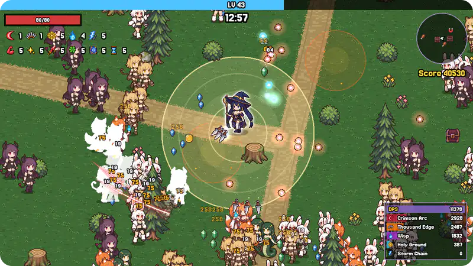
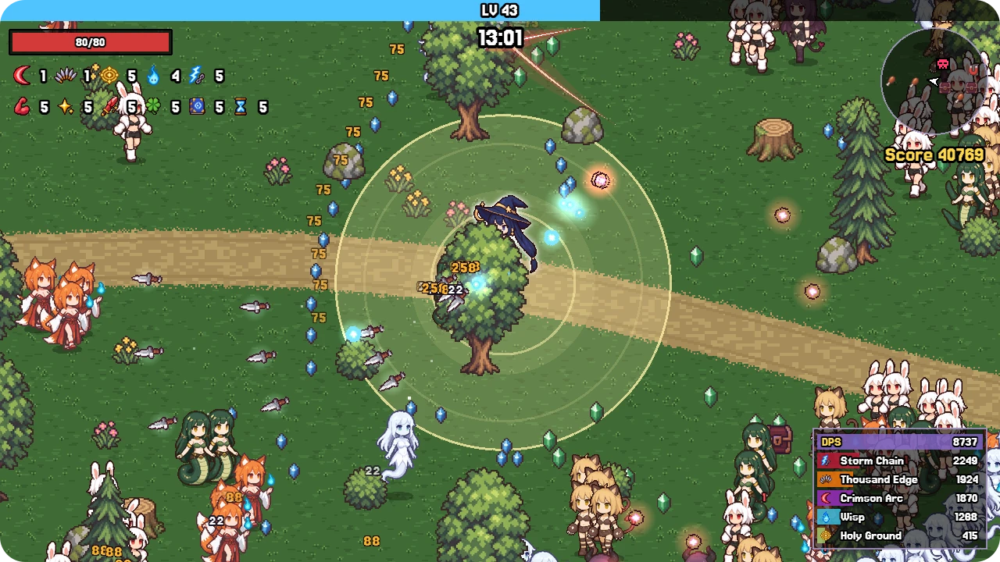
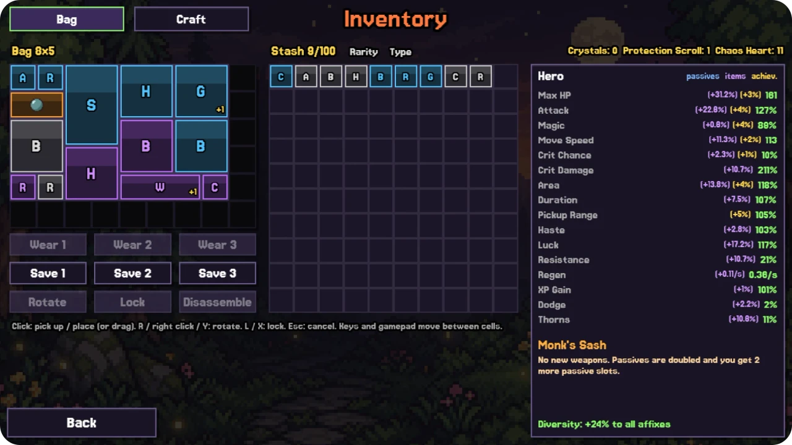
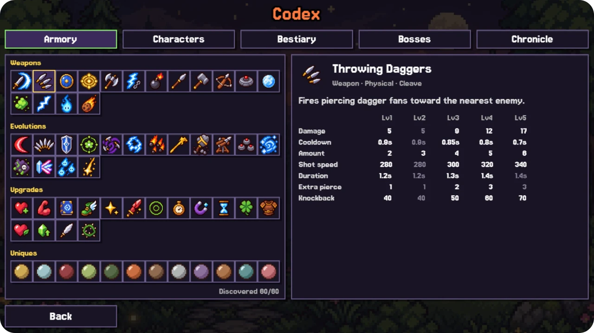
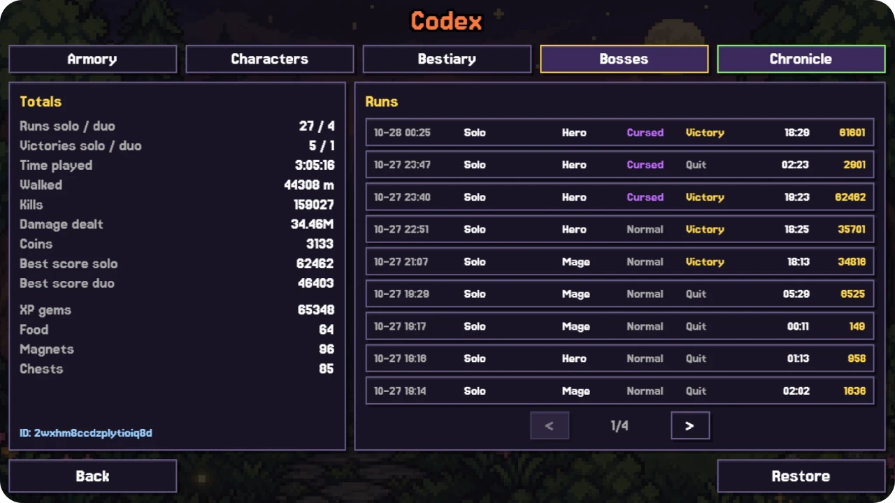

# Fury Survivors

<p align="center"></p>

A small game in the spirit of Vampire Survivors and HoloCure, built on Phaser 3 with no build step. The whole project was assembled by Claude Code from a single brief in two five-hour Claude Code sessions. Opus 5.5 ran the session, planned the work, wrote most of the code and reviewed it, while Sonnet 5.5 subagents took separate coding tasks in parallel. The art was drawn by GPT 2.5 Flare and animated in PixelLab.

Two more five-hour sessions added a second heroine, two-player online co-op, new difficulty, overtime with new reaper boss, roads and new scenery, a minimap and a DPS meter. osses drop item chests, items go into a bag you pack like Tetris, and a stash, crafting and achievements carry progress from run to run. A codex keeps every weapon, enemy and past run. The game runs in the browser at https://leinstay.github.io/fury-survivors/.

## Features

* Two heroes. Hero fights with a blade (Blade Arc), Mage with chain lightning (Storm Chain). Each has their own strengths and weaknesses.
* One stage, 15 minutes in a forest with sandy roads, crossroads and roadside objects. Enemy waves follow a timeline, with special events (an enemy wall, a flock flyover, a ring that closes in, a horde around a chest), elites that drop skill chests, and a boss every five minutes. Kitsune Empress comes at 5:00, Harpy Queen at 10:00 and the final Dryad Queen at 15:00.
* Overtime after the final boss. Endless waves that keep getting stronger, played for score, until the Reaper arrives at 20:00. Her touch kills, and only the Bible lets you hurt her while she stands in a holy circle.
* Normal or Cursed difficulty (40% more enemies with 8% more HP), chosen before a run.
* 16 weapons with 5 levels each, 16 passives, card picks with reroll, skip and banish. Weapons are tagged by damage type (physical or magical) and targets (AoE, cleave or single).
* 16 evolutions, one for every weapon paired with a passive. A skill chest offers them once the weapon is maxed and the passive is taken.
* 8 enemy types with elite variants, 3 bosses with their own attacks and the overtime Reaper.
* Boss loot. Every boss drops a loot chest on the ground that you have to fight your way to, and it can be lost. Items come as common, rare and epic with random affixes, plus 12 uniques that change the rules of a run.
* A Tetris-like bag. Items have shapes and rotate, the bag grows from 7x4 to 9x6 and rewards mixing item types. A stash for 100 items and three bag presets.
* Crafting with crystals, protection scrolls and chaos hearts: reroll affixes, raise rarity, merge, enchant and disassemble.
* 24 achievements in six categories that pay out currency, bag space and small permanent stat bonuses.
* Codex with Armory, Characters, Bestiary, Bosses and Chronicle (totals and run history), synced to Firestore and restorable by ID.
* Two-player online co-op. The host creates a lobby and shares a code, the second player joins by code, each picks their own hero and the host picks the difficulty. One screen, shared experience, cards taken in turns from each player's own pool, a coffin instead of death, and more enemies for two. P2P over WebRTC, lobby through Firestore.
* HUD with score, minimap and a per-weapon DPS meter.
* Online leaderboards on Cloud Firestore, solo and co-op separately.

## Screenshots

<p align="center"></p>
<p align="center"></p>
<p align="center"></p>
<p align="center"></p>

## Controls

| Action | Keyboard | Gamepad | Touch |
|---|---|---|---|
| Move | WASD or arrows | left stick or d-pad | drag anywhere |
| Select | Enter or Space | A | tap |
| Back or pause | Esc | B or Start | pause button |

In the inventory, R or right click rotates an item and L locks it.

## Running

There is no build step. The game is plain ES modules and Phaser 3.90 lives in `vendor/`, so any static server works:

```bash
npx http-server -p 8080 -c-1
```

Then open http://localhost:8080.

## Layout

```
src/data/            all balance and content (weapons, passives, evolutions, enemies, bosses, items, stage timeline)
src/core/            simulation without Phaser
src/behaviors/       weapon and enemy behaviours, registered by name
src/render/, src/scenes/, src/ui/    the Phaser layer
src/services/        leaderboard, online co-op, codex, stash and achievements sync (Firestore, WebRTC)
assets/sprites/manifest.js    every sprite by key
```

## License and credits

MIT License, see [LICENSE](LICENSE). The game runs on [Phaser](https://phaser.io) 3.90.0 (MIT). The Jersey 15 font is by The Soft Type Project Authors under the SIL Open Font License 1.1. The license text is in `assets/fonts/OFL.txt` and the source is at https://github.com/scfried/soft-type-jersey. Sound effects are generated by an in-house sfxr-style synthesizer with no third-party samples. The background music is "Whispers of the Abyss", a royalty-free track. Art was generated by `openai/gpt-image-2.5-flare` through OpenRouter and animated in [PixelLab](https://pixellab.ai), then cleaned and sliced by in-house scripts. Mechanics are inspired by Vampire Survivors and HoloCure, and no assets or names from either game are used.
