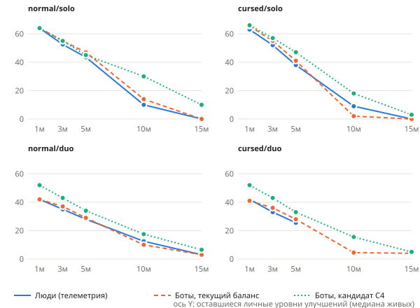

# Аудит баланса: 24 октября 2026

Код: `main` 87e1379 (source в `src/data/build.js` 46fb2f27…), модель выбора `human-a0cd1f09fa4f`,
профили `human-provisional-2`. Данные: полная выгрузка `fury_runs` (все страницы, без фильтра периода).
Ничего из баланса не опубликовано и в `src/data/` не изменено: ниже кандидаты и их проверка.

## 1. Вердикт

| Утверждение | Уверенность |
| --- | --- |
| Сборка исчерпывается слишком рано: у людей к 10:00 в solo остаётся 9–10 личных уровней улучшений, к 15:00 — 0 у всех 6 выживших; auto-heal начинается в 11:38–14:09 | высокая (люди и боты совпадают) |
| Причина — кривая опыта: она дословно взята из Vampire Survivors (5, +10/+13/+16, доплаты 600/2400), где этап 30 минут, а у нас 15; компенсации Growth +100% после 20/40 у нас нет | высокая |
| Сложность сосредоточена в окне 5:00–8:00: все 10 человеческих смертей в 205–468 с; почти все, кто пережил 10:00, побеждают | высокая для solo, умеренная для duo |
| Дуо слишком тяжёлое не из-за урона, а из-за личной прогрессии: на 5:00 у игрока дуо 17–19 личных взятий против 24–31 в solo; цена «за личный круг» снижает смертность ботов-дуо с 93% до 25% | умеренная (направление надёжно, величина смещена моделью движения) |
| Боты в дуо получают в 1.8–2.5 раза больше урона, чем люди: доли смертей дуо у ботов — оценка сверху | высокая по направлению, n людей мало |
| Storm Chain и её эволюции доминируют, Blade Arc и щитовые эволюции почти не наносят урона | высокая |
| Зависания/обрывы дуо: правдоподобный механизм найден и воспроизведён (остановленный цикл кадров у одного игрока) | умеренная: совпадает с телеметрией, но не доказан у этих пользователей |
| Цели 50%/75% и «cursed без эволюций ≈ невозможно» не подтверждены: квалификационной выборки (≥400 на режим) нет | — |

## 2. Данные

Выгрузка 2026-10-23T23:16Z: **23 документа, 0 отклонено**, `createdAt` 2026-10-23 02:10Z – 23:06Z.
Снимок: `docs/simulation-evidence/telemetry-2026-10-24.json.gz` (sha256 несжатого 023b9c30…,
manifest рядом). Ники/IP в записях нет, sessionId захеширован экспортёром.

| Версия | Схема | Режим | Документов | Сессий | Исходы сессий |
| --- | --- | --- | ---: | ---: | --- |
| 0fc7e5 | v1 | solo cursed | 11 | 11 | 5 победа, 5 смерть, 1 выход (115 с) |
| 0fc7e5 | v1 | solo normal | 2 | 2 | 1 победа, 1 смерть |
| e58f49 | v2 | duo cursed | 5 | 3 | 1 смерть команды, 2 disconnect |
| e58f49 | v2 | duo normal | 1 | 1 | disconnect |
| 6ef720 | v2 | duo normal | 4 | 2 | 1 победа, 1 смерть команды |

- Совместимость: между 0fc7e5 и 87e1379 в `src/data` и behaviors изменились только телеметрия,
  `xpLevelScale` (по умолчанию 1, без эффекта) и фикс устаревшего щита (`_blocked`). Числа баланса
  одинаковы — все 23 документа сопоставимы. Смена `ver` объясняется хешем `BUILD` в отпечатке.
- **v2 solo нет ни одного.** Все solo — v1 одного героя (mage), вероятно, 1–2 человека. Дуо — 6 сессий,
  в 2 из них второй документ не дошёл (у обрыва вкладку, видимо, закрыли: незаконченный забег не сохраняется).
- Пригодность. Обучение выбора: 23 документа (1051 добровольных действий), но v1 без контекста HP/бюджетов.
  Баланс по исходам: 13 solo-сессий + 3 завершённые дуо-сессии; disconnect (3) из исходов исключены и
  показаны отдельно, не как смерти. Движение и входящий урон в окне: только 10 документов v2 дуо.
  Технические сбои: 3 disconnect, у двух нет второго документа, у e58f49 нет `terminal`.

## 3. Четыре режима: люди и боты

Боты: `balance:quick`-когорта, tuning seeds, 40 матчей на режим, дуо считается по команде.
Повтор той же когорты с телеметрией дал побитно те же исходы (наблюдатели не трогают RNG).
L — уровень, T — личные взятия карточек, left — оставшиеся личные уровни улучшений (с учётом слотов,
поглощённых компонентов и banish), медианы по живым на этой минуте, n — число живых игроков.

| Режим | Источник | Исходы | 5:00 L / T / left (n) | 10:00 | 15:00 |
| --- | --- | --- | --- | --- | --- |
| normal solo | люди | 1 П, 1 С | 28.5 / 27.5 / 43.5 (2) | 59 / 58 / 10 (1) | 85 / 74 / 0 (1) |
| normal solo | боты | 16 П, 24 С: **60%** [45–74] | 25 / 24 / 47 (37) | 53 / 52 / 14 (18) | 80 / 65.5 / 0 (16) |
| cursed solo | люди | 5 П, 5 С, 1 выход | 36 / 35 / 38 (9) | 69 / 68 / 9 (5) | 91 / 77 / 0 (5) |
| cursed solo | боты | 6 П, 33 С, 1 timeout: **83%** [68–91] | 32 / 31 / 41 (23) | 63 / 62 / 2 (7) | 96 / 71 / 0 (7) |
| normal duo | люди | 1 П, 1 С, 1 DC | 40 / 19 / 28 (5) | 75 / 37 / 12.5 (2) | 108 / 53 / 3 (2) |
| normal duo | боты | 3 П, 37 С: **93%** [80–97] | 36 / 17 / 29 (74) | 75 / 37 / 10 (8) | 107 / 49.5 / 3 (6) |
| cursed duo | люди | 1 С, 2 DC | 44 / 21.5 / 25.5 (2) | — | — |
| cursed duo | боты | 1 П, 39 С: **98%** [87–100] | 40 / 19 / 28 (52) | 91 / 42 / 4.5 (2) | 113 / 48.5 / 4 (2) |

Время первого auto-heal (выбор исчерпан) у людей: normal 810 с; cursed 698, 736, 746, 833, 849 с;
дуо normal 958/964 с. У ботов на 15:00 исчерпаны 12/16 normal и 7/7 cursed solo.



Смерти: у людей 205–468 с (cursed solo 205, 332, 338, 413, 428; normal solo 421; дуо 420 и 468),
убийцы — лисы (dash), суккубы, слизни, призраки, первый босс. У ботов медиана смерти 414 с normal solo,
364 с normal duo; главный убийца тоже foxgirl. Это волны 300–480 с (`forest.js`: лисы, суккубы, ламии).

## 4. Достоверность ботов

Подтверждено:
- **Темп уровней** совпадает (таблица выше): расхождение медиан ≤ 4 уровней на 1/3/5 мин во всех
  режимах, кроме cursed solo на 1:00 (6.5 у ботов против 9).
- **Выбор карточек** на новых данных, которых не было в обучении (`tools/telemetry/holdout.mjs`,
  10 документов v2, 272 взятия): top-1 модели **60.6%**, «первая карта» 26.1%, равномерный 25.7%,
  logloss 1.026. Для мечницы только **48%** (модель обучена на одной mage).
- **Входящий урон в solo** по всему забегу: люди 19.4 (normal, n=2) и 27.9 (cursed, n=11) в минуту,
  боты 20.6 и 27.3.

Расхождения (ограничивают выводы):
- **Движение в дуо.** Окно 1:00–7:00: люди получают 8.9 (normal) / 18.7 (cursed) урона в минуту,
  боты 22.3 / 33.3. Медиана расстояния до ближайшего врага у людей 148/129 px, у ботов 80/74 px.
  Боты без цели идут к ближайшему врагу и в толпу за опытом. Пробная «дистанция удержания» 110–140 px
  почти не изменила картину (82–92 px) — нужна перестройка движения, она откатана, модель не менялась.
  Следствие: **смертность ботов-дуо — оценка сверху**.
- **Диверсификация в дуо.** Когда в предложении есть и новое оружие, и прокачка, люди-дуо берут новое
  в 44% (normal) случаев, боты в 7%. Концентрация на одном оружии в первые 5 минут совпадает (0.50).
- Простой (нулевой ввод) у людей-дуо 8–9% времени, у ботов 13–19%.

Вывод: темп прогрессии и выборы ботов годятся для оценки экономики опыта; доли поражений solo —
ориентир; доли поражений дуо — только верхняя граница. Не калибровать дуо-сложность по ботам,
пока не будет новых данных движения (в том числе v2 solo).

## 5. Опыт и прогрессия: подтверждённые проблемы и проверка гипотез

Ёмкость сборки: solo 6+6 слотов = 6·7 + 6·5 − 1 = **71** личное улучшение, дуо 4+4 = **47**.
Люди solo достигают её к 11–14 мин. Накопленный опыт до уровня (текущая кривая): L30 4.9k, L50 16.4k,
L70 31.8k. Доход выживших людей cursed solo: 7.1k к 5:00, 30.9k к 10:00, 54.8k к 15:00 — во второй
половине этапа он растёт (больше врагов и сильнее сборка), а цена уровня растёт линейно.

Дуо: общий уровень, карточки по очереди. При той же минуте у игрока вдвое меньше личных взятий за
номер уровня, а `xpForLevel` растёт после каждой карточки команды. На 5:00 люди-дуо: T 19–21.5 при L 40–44.

Гипотезы проверены по одной на tuning seeds (те же seed/профили, 40 матчей на режим; % — поражения):

| Вариант | normal solo | cursed solo | normal duo | cursed duo | left на 15:00 (n-s / c-s / n-d / c-d) |
| --- | ---: | ---: | ---: | ---: | --- |
| Текущий | 60 | 83 | 93 | 98 | 0 / 0 / 3 / 4 |
| H1 гладкая A (10/25/45, без доплат) | 73 | 80 | 100 | 100 | 2 / 0.5 / — / — |
| H2 A + cursed XP 0.8 | 73 | 85 | 100 | 100 | 2 / 3.5 / — / — |
| H3 A + личный круг 1.5 | 73 | 80 | 68 | 88 | 2 / 0.5 / 1 / 4 |
| H4 A + личный круг 2 | 73 | 80 | 25 | 53 | 2 / 0.5 / 2 / 0 |
| H5 A + круг 2 + coopXP 1.0 | 73 | 80 | 45 | 60 | 2 / 0.5 / 2 / 0 |
| H6 только реген героя +0.3 | 45 | 73 | 83 | 100 | 0 / 0 / 1.5 / — |
| C1 A + реген .25 + круг 2 + coopXP 1 + cursed XP .9 | 57 | 85 | 35 | 63 | 5 / 0 / 2 / 0.5 |
| C2 B (10/25/55, ступень с 35) + реген .3 + круг 2 + coopXP 1 | 48 | 80 | 23 | 45 | 10 / 2.5 / 2 / 0 |
| C3 C1 без cursed XP, дуо 5+5 слотов | 57 | 78 | 35 | 60 | 5 / 0 / 5 / 2.5 |
| **C4** B + реген .25 + круг 2 + coopXP 1 + cursed XP .9 + дуо 5+5 | 55 | 80 | 25 | 85 | 10 / 3 / 6.5 / 5 |

Выводы по гипотезам:
- Только замедлить опыт (H1/H2) — сохраняет варианты в solo, но поднимает смертность solo normal
  (60→73%) и не трогает дуо. Это подтверждает: XP — рычаг «сколько выбора», а не «кто доживает до 8:00».
- Личный круг (`coopLevelScale` 2) — главный рычаг дуо, но при 4+4 слотах сборка дуо исчерпывается
  к 10–12 мин (auto-heal у 39–60 из 44–64 выживших). Ограничение — ёмкость, а не опыт.
- Базовый реген (предложение пользователя) помогает в основном solo (normal −15 п.п.) и почти
  не помогает дуо (−10 п.п. normal, cursed без изменений). Дуо он не чинит, но компенсирует
  замедление XP в solo.
- Одна cursed-доплата XP 0.8–0.9 уменьшает положительную обратную связь «+50% врагов → +50% XP»:
  уровень cursed на 15:00 при C4 61.5 против 97.5.

Проверка **C4 на validation seeds** (не использовались при подборе; 40 на режим):

| Режим | Текущий: поражения [95% CI] | C4: поражения [95% CI] | C4: left на 15:00 | C4: auto-heal до 15:00 |
| --- | --- | --- | --- | --- |
| normal solo | 57% [42–71] | **43%** [29–58] | 10 (n=23) | 1 |
| cursed solo | 75% [60–86] | **85%** [71–93] | 6.5 (n=6) | 1 |
| normal duo | 93% [80–97] | **45%** [31–60] | 6.5 (n=44) | 10 |
| cursed duo | 100% [91–100] | **83%** [68–91] | 3.5 (n=14) | 2 |

Cursed без супероружий (validation, 40 на режим): текущий solo 4/40 побед (верхняя 95% граница 21%),
дуо 0/40 (7%); C4 solo 2/40 (15%), **дуо 7/40 (30%)**. В дуо при C4 отказ от эволюций не меняет
итог (83% и 83%): там исход решает окно 5–8 минут, а не сундук. Требование «≤5%» не подтверждено ни для
текущего баланса, ни для C4: для него нужно ≥200 матчей на режим и ноль-немного побед.

Критерии квалификации (`SIMULATION_GUIDE.md`): ≥400 независимых qualification-матчей на режим, весь
95% CI внутри 45–55% / 70–80%. **Данных недостаточно**: здесь 40 на режим (CI шириной ~30 п.п.),
а модель движения дуо смещена. Qualification-сиды не использовались и остаются независимыми.

## 6. Оружие

Естественные забеги ботов (минуты полного владения, медианы) и людей v2; контролируемые пробы —
`docs/simulation-evidence/combat.json` (L7, бессмертие, общий motion tape).

| Оружие | Урон/мин ранняя фаза (lv) | Доля урона игрока ранняя / средняя | Overkill raw/dealt | Проба L7 толпа / стрелки, DPS | Входящий HP в пробе толпа |
| --- | --- | --- | --- | --- | --- |
| Storm Chain | 5366 (3) | 0.64 / 0.46 (люди 0.78 / 0.66) | 2.03 | 452 / 273 | 124 |
| Firebomb | 2652 (3) | 0.29 / 0.20 | 1.32 | 641 / 225 | 127 |
| Throwing Daggers | 3280 (3) | 0.41 / 0.16 | 1.41 | 455 / 151 | 134 |
| War Axe | 1178 (2) | 0.17 / 0.07 | 1.44 | 237 / 50 | 130 |
| Guardian Shields | 1215 (2) | 0.15 / 0.05 | 1.65 | 320 / 43 | 144 |
| Holy Ground | 889 (2) | 0.10 / 0.05 | 1.23 | 78 / 17 | 80 |
| Blade Arc | 864 (3) | 0.16 / 0.03 | 1.67 | 83 / 15 | 83 |

Подтверждено:
- **Storm Chain доминирует** и у людей, и у ботов; её overkill 2.0 означает, что половина урона уходит
  в уже убитые цели — она сильна именно ранним «одноударным» добиванием.
- **Blade Arc слаб сам по себе**, а не только из-за конкуренции: в контролируемой толпе 83 DPS против
  452–641. Конкуренция тоже есть: доля урона меча в ранней фазе 0.28 без Storm Chain и 0.05 с ней,
  0.26/0.07 без/с ножами; 65% его добиваний — по целям, которые уже били другие источники.
  Ближний бой даёт меньше входящего урона в толпе (83 против 124–144), это его защитная ценность.
- **Эволюции** различаются на два порядка: Plasma Storm 150–200k урона/мин, Thunder Loop 76–139k,
  Thunder Knives 113–158k против Crimson Arc ~10k, Aegis Bastion 2–3k, Bulwark Spin/Aegis Storm ~3k.
- **Щиты**: в пробе со стрелками 23 уничтоженных снаряда и входящий урон 11 против 36–40 у ножей и
  молнии, то есть защитная польза реальна и не видна в DPS. Поведение совпадает с кодексом: снаряды
  уничтожаются, а не отражаются. В естественных дуо-забегах команды со щитами к 5:00 победили 3/25,
  без щитов 0/12 (normal) — согласуется с наблюдением пользователя, но выборка мала (p≈0.3),
  в solo связи нет (11/24 без щитов против 5/13 со щитами).

### 6.1 Ребаланс оружия: эксперименты (не применены)

Исход сильно зависит от стартового оружия. Текущий баланс, solo, победы из 20 (tuning / validation):
магесса (старт Storm Chain) normal 13 / 12, cursed 5 / 9; мечница (старт Blade Arc) normal 3 / 5,
cursed 1 / 1. Средние «57–60% поражений» складываются из лёгкой магессы и почти непроходимой мечницы.

В первые 5 минут (урон в минуту полного владения, боты): Storm Chain 5.4k; ножи 3.3k и бомба 2.7k
отстают в ~1.7 раза; меч, аура, топор и щиты (0.9–1.2k) — в 4.5–6 раз. В контролируемой пробе L7
меч и аура слабее молнии в 5–6 раз. Нерф одной молнии без подъёма остальных делает 1–8 мин непроходимыми
для всех, кроме ножей и бомбы: поэтому сначала поднимаем слабую четвёрку, потом опускаем молнию к ним.

Сравнение с Whip из Vampire Survivors ([вики](https://vampire.survivors.wiki/w/Whip)): 10 урона / 1.35 с,
2 удара в обе стороны, +5 урона почти каждый уровень до 40, площадь +20% к максимуму, проходит сквозь
всех. Числа нашего меча почти те же (10→36). Отличия, которые его убивают: (1) наши враги после
удвоения HP — слизь 24, кошка 32, лиса 160, и 10 урона не убивает даже первую волну, тогда как в VS
кнут ранней игры убивает с одного удара; (2) длина удара 62–86 px, а люди-дуо держат ближайшего врага
на 130–150 px (доля урона меча у людей 1%), боты на ~80 px. Поэтому один урон меча почти не помогает
(×2.8 урона → реальный урон в забеге 864 → 1460 в минуту), а длина удара помогает сразу.

| Вариант (текущий XP, tuning, 20 на героя / 40 дуо) | Меч, урон/мин 0–5 мин | Молния | Доля молнии | Мечница normal: победы / дожили до 8:00 | Магесса normal | Мечница cursed | Поражения normal solo / cursed solo |
| --- | ---: | ---: | ---: | --- | --- | --- | --- |
| Текущий | 864 | 5366 | 0.64 | 3 / 4 | 13 / 14 | 1 / 1 | 60% / 83% |
| W1 меч урон ×~2 | 1317 | 6477 | 0.68 | 6 / 11 | 13 / 13 | 3 / 6 | 53% / 70% |
| W2 W1 + молния L1–4 −30% | 1432 | 4602 | 0.61 | 6 / 11 | 11 / 12 | 3 / 6 | 57% / 80% |
| W4 меч ×2.8, аура ×2.4, топор ×2, щиты ×1.8, молния L1–4 −30%, L5–7 −13% | 1460 | 4661 | 0.59 | 5 / 14 | 15 / 15 | 1 / 7 | 50% / 83% |
| **W5** W4 + длина меча на 2 ступени колец (78→115 px), молния L1–4: 12–15 урона, 2–3 прыжка | **3118** | **3745** | **0.52** | 9 / 16 | 17 / 17 | 5 / 12 | 35% / 70% |

W5 впервые выравнивает раннюю силу: меч 3.1k, молния 3.7k, ножи 3.6k, бомба 2.5k в минуту. Мечница
переживает 8:00 в 16 из 20 normal (было 4). Остались: топор и щиты ~1k (щиты платят защитой,
топору нужен подъём), разрыв героев по победам (у магессы atk ×1.25 и crit 15% ко всему оружию).

Вместе с XP-пакетом (C4W5) игра становится слишком лёгкой: normal solo 20%, normal duo 15%, cursed
solo 80%, cursed duo 55%. Это ожидаемо — C4 подбирался при слабом мече. Следующий шаг: принять W5 как
основу оружия и заново подобрать давление волн 5–8 мин или XP при нём; не публиковать W5 без этого.
Конфиги: `docs/simulation-evidence/balance-audit/W1…W5.json`, `C4W4.json`, `C4W5.json`;
`node docs/simulation-evidence/balance-audit/byhero.mjs W5` — исходы по героям и доли урона.

### 6.2 Лестница урона по дальности (правило владельца): R2

Правило: чем ближе бьёт оружие, тем выше урон за удар; дальнобойное и со встроенными свойствами
(цепь, огонь, блок снарядов, возврат) — ниже, без огромного разрыва. Молния бьёт дальше всех и по многим
целям за экраном, поэтому у неё урон за удар самый низкий. Глобально игра не должна стать сложнее:
поражения в каждом режиме не выше текущих на тех же сидах.

| Оружие | Дальность | Урон за удар L1 → L7 сейчас | R2 | Перезарядка R2 |
| --- | --- | --- | --- | --- |
| Меч | 78–115 px (было 62–86) | 10 → 36 | 20 → 56 | 1.0 → 0.8 (было 1.35 → 1.2) |
| Щиты | орбита ~55 px, блок | 12 → … | ×1.5 | без изменений |
| Топор | 110–185 px, возврат | 12 → 25 | ×1.6 (19 → 40) | ×0.75 |
| Аура | вокруг героя, постоянно | 5 → 15 | ×2 (10 → 30) | ×0.8 |
| Бомба | бросок + огонь | 10 → … | без изменений | без изменений |
| Ножи | ~340 px, пробивание | 8 → … | без изменений | без изменений |
| Молния | 230–290 px + 3–5 прыжков | 18 → 35 | 8 → 16 | 1.1 → 0.95 (было 1.25 → 1.1) |

Результаты (текущий XP, 40 матчей на режим; соло по героям 20/20):

| | Поражения normal solo | cursed solo | normal duo | cursed duo |
| --- | ---: | ---: | ---: | ---: |
| Текущий, tuning | 60% | 83% | 93% | 98% |
| R2, tuning | 30% | 73% | 95% | 98% |
| Текущий, validation | 57% | 75% | 93% | 100% |
| R2, validation | 38% | 70% | 88% | 95% |

Validation: мечница normal 5 → 10 побед из 20 (до 8:00 дожили 9 → 15), cursed 1 → 6; магесса normal
12 → 14, cursed 9 → 6 (tuning 5 → 6; при n=20 это в пределах шума, но магессу на cursed стоит проверить
отдельно). Урон в минуту в первые 5 минут: молния 6.1k → 5.1k, меч 0.8k → 2.4k, ножи 3.7k, бомба 2.1k,
аура 1.0k → 1.6k, топор 1.2k → 1.4k, щиты 0.6k (платят блоком). Молния остаётся сильнейшей по сумме
(много целей), но разрыв ~1.4× вместо 5–7×. Дуо почти не меняется: его ограничение — личная прокачка
(раздел 5), а не оружие. Требование «не сложнее» выполнено во всех четырёх режимах на обоих наборах сидов.
Конфиг: `docs/simulation-evidence/balance-audit/R2.json`.

### 6.3 Кандидат F3: молния и ножи ниже ближнего боя, cursed и дуо легче текущего

Требование владельца: молния и ножи (самые дальнобойные) опускаются до уровня остальных и бьют слабее
меча и топора; cursed и дуо при этом проходятся лучше, чем сейчас. Рычаги: кривая опыта и лимит
одновременных снарядов обычных врагов (снаряды боссов не ограничиваются).

Новое в коде: `COMBAT.maxEnemyShots` (по умолчанию `Infinity`, поведение не меняется): суккуба не
стреляет, пока летит столько снарядов обычных врагов; снаряды боссов помечены `boss` и не считаются.
Замер текущего баланса (медиана пика за минуту / максимум): до 5:00 ноль, 6:00 — 6–10 / до 21,
8:00 — 23–34 / до 169, 14:00 в дуо — 36–49.

F3 = урон за удар (L1 → L7): меч 20 → 56 (удар 78–115 px, перезарядка 1.0 → 0.8), топор ×1.6 и
перезарядка ×0.75, щиты ×1.5, аура ×2 и перезарядка ×0.8, бомба без изменений, ножи ×0.7 (6 за удар),
молния 7 → 14, 2–4 прыжка, исходная перезарядка 1.25 → 1.1; опыт: без доплат 600/2400 на 20/40;
дуо `xpLevelScale` 1.5, `xpMul` 1.0; `maxEnemyShots` 12; магесса maxHp 80 → 120.

| Поражения | normal solo | cursed solo | normal duo | cursed duo |
| --- | ---: | ---: | ---: | ---: |
| Текущий, tuning | 60% | 83% | 93% | 98% |
| F3, tuning | 43% | 60% | 43% | 68% |
| Текущий, validation | 57% | 75% | 93% | 100% |
| F3, validation | 35% [22–50] | 55% [40–69] | 43% [29–58] | 53% [37–67] |

Вклад рычагов (tuning): только оружие R3 — normal solo 70%, магесса 3/20 побед (молния её тащила);
+ дуо-кривая 2.0 — дуо 35% / 65%; + лимит снарядов 12 — cursed solo 78 → 70%, cursed duo 65 → 50%;
+ без доплат XP — normal solo 50%, но дуо 13% / 30% (слишком легко) → круг 1.5 вместо 2.

Урон в минуту в первые 5 минут, текущая кривая XP, только оружие (R3): меч 3.4k, молния 2.8k, ножи 2.8k,
бомба 2.7k, топор 1.7k, аура 1.6k, щиты 0.9k. В F3 у молнии 3.7–4.1k из-за быстрой прокачки в дуо.
Validation по героям (побед из 20): мечница normal 5 → 16, cursed 1 → 12; магесса normal 12 → 10,
cursed 9 → 6 (tuning: 13 → 10 и 5 → 6). Магесса без молнии-«тащилы» остаётся чуть хуже текущей —
единственный срез, где «не сложнее» выполнено не полностью; следующий рычаг — её стартовая молния L1.
Цена: без доплат XP сборка к 15:00 снова исчерпана (left 0), то есть цель «варианты к 15:00» отложена
ради проходимости; её возвращает поздняя кривая (раздел 5), но уже под F3.

### 6.4 Кандидат F4 и поиск еды ботами (профили human-provisional-3)

Люди в дуо подбирают еду 0.35–0.4 раза в минуту при ~85% HP (`tools/telemetry/food.mjs`), боты шли к
ней только ниже 60% HP: 0.17–0.18 в дуо, в solo часто при полном HP (случайно). Теперь бот не трогает
еду выше 92% HP и идёт к ней с приоритетом 2 + 10 × доля потерянного HP: 0.28–0.31 в минуту при 70–84%.
Входящий урон в окне 1–7 мин не изменился (это вопрос уклонения, раздел 4). Текущий баланс пересчитан
этими ботами (P3) — сравнение только с ним.

F4 = F3, но HP магессы 80 (как сейчас), щиты без изменений (×1), топор урон ×1.6 и перезарядка ×0.5
(3.0 → 1.5 с на L1). Урон за удар L1: меч 20, топор 19, щиты 12, бомба 10, аура 10, молния 7, ножи 6.

| Поражения | normal solo | cursed solo | normal duo | cursed duo |
| --- | ---: | ---: | ---: | ---: |
| Текущий (P3), tuning | 57% | 83% | 90% | 100% |
| F4, tuning | 45% | 50% | 48% | 78% |
| Текущий (P3), validation | 45% | 83% | 100% | 100% |
| F4, validation | 40% [26–55] | 55% [40–69] | 53% [37–67] | 78% [62–88] |

Урон в минуту 0–5 мин (validation): молния 6.2k → 3.9k, меч 0.85k → 2.8k, ножи 3.0k → 2.9k, бомба 2.8k,
топор 1.1k → 1.9k, аура 1.0k → 1.7k, щиты 0.6k. Магесса (validation): normal 15 → 10, cursed 7 → 6 побед
из 20 (tuning 16 → 6 и 7 → 6); мечница normal 5 → 14, cursed 0 → 11. Все режимы легче текущего,
но магесса на normal без молнии-«тащилы» заметно слабее прежней.

### 6.5 Применено в `src/data` (24.10.2026)

F4 перенесён в данные: `weapons.js` (меч, топор, аура, ножи, молния; щиты и бомба без изменений),
`constants.js` (`XP.thresholds = []`, `COMBAT.maxEnemyShots = 12`), `coop.js` (`xpLevelScale` 1.5,
`xpMul` 1). HP магессы 80. После слияния с main (оружие ломает объекты без врагов рядом) контроль на
validation-сидах, 40 на режим: поражения normal solo 40%, cursed solo 48%, normal duo 57%,
cursed duo 60% (текущий баланс до этого: 45 / 83 / 100 / 100%). Unit 193/193, smoke 7/7.

Не балансировать оружие до решения по опыту и движению дуо: при более медленной прокачке
поздние эволюции появляются позже и их вклад меняется.

## 7. Надёжность и зависания дуо

- Все 3 disconnect произошли в пределах 1 с игрового времени от экрана выбора улучшения:
  fb7e9e — через 0.9 с после выбора (решение 9.5 с); ed51bb — у хоста открытое предложение в момент
  обрыва; c1e41b — через 0.4 с после выбора гостя, который думал **21.5 с** (`NET.dropAfter` = 20 с).
  Случайно такое совпадение маловероятно (окно ~1 с при выборе раз в 5–10 с). Это версия e58f49 — до фикса паузы 835f460;
  на 6ef720 две сессии завершились без обрыва.
- **Механизм, воспроизведённый по WebRTC** (`tests/smoke/coop-hidden.spec.js`, запуск
  `FURY_DUO_HIDDEN=1 npx playwright test tests/smoke/coop-hidden.spec.js`): если у одного игрока
  остановлен цикл кадров (вкладка в фоне, свёрнутый браузер, переключение приложения на телефоне —
  браузер перестаёт вызывать requestAnimationFrame), он не шлёт тики. Второй сразу замирает с
  экраном выбора («зависание без Escape»), а сам тоже перестаёт отправлять, потому что новый тик
  не посчитан. Через 20 с оба получают disconnect; при уходе на 8 с сессия восстанавливается.
  Вероятный пользовательский сценарий: ожидающий игрок переключается, пока напарник выбирает.
- Дополнительный дефект: `Game.now()` = `game.loop.time`, который в фоне не идёт; сообщения,
  пришедшие в скрытую вкладку, пишут устаревшее `lastRemoteT`.
- Исправление (не сделано, решение за владельцем): поддерживать обмен из таймера, когда
  `document.hidden` (в фоне таймеры Chrome срабатывают ~1 раз/с, этого хватает на heartbeat и
  догон тиков), показывать «напарник отошёл» и не обрывать сессию в состояниях levelup/chest/pause;
  считать тишину по `performance.now()`. На телефоне при блокировке JS останавливается полностью —
  нужен более длинный порог в экранах выбора.
- disconnect/timeout/ошибки отделены от смертей во всех таблицах; ошибок симулятора в ~2 500
  прогонах аудита нет, 1 timeout (cursed solo baseline).

## 8. Ранжированные предложения

1. **Кривая опыта B без доплат** — `src/data/constants.js` `XP.steps = [{below: 20, per: 10},
   {below: 35, per: 25}, {below: Infinity, per: 55}]`, `XP.thresholds = []`. Причина: кривая VS
   рассчитана на 30 минут. Эффект (validation, C4): к 15:00 в solo остаётся 6.5–10 уровней,
   auto-heal до 15:00 у 1 из 23/6 выживших против 11/9 сейчас. Ранний темп сохраняется (5:00 L 25–28).
2. **Базовый реген героев 0.25 HP/с** — `src/data/heroes.js` `stats.regen` обоих героев и `HERO_BASE.regen`
   (иначе на экране выбора появится ложная черта «+regen»). Компенсирует более медленную прокачку
   в solo (H6: normal 60→45%). Пассивка regen (+0.2…1.0) остаётся осмысленной.
3. **Дуо: личный круг и ёмкость** — `src/data/coop.js` `xpLevelScale: 2`, `xpMul: 1`,
   `slots: {weapons: 5, passives: 5}`. Цена уровня считается по личным кругам; 5+5 слотов дают ёмкость
   59 вместо 47, поэтому варианты остаются к 15:00. Проверено только ботами с завышенной смертностью
   дуо: реальная сложность дуо при этом, вероятно, ниже 45/83%. Перед публикацией — новые v2-сессии.
4. **Cursed XP 0.9** — `src/data/difficulty.js` `cursed.xpMul: 0.9`. Уменьшает обратную связь
   «больше врагов → больше опыта». Cursed solo на validation 85% [71–93] — верх цели; если после
   квалификации окажется выше 80%, первым откатывать этот пункт (H1: 80% без него).
5. После XP: **оружие** — ослабить overkill-раннюю силу Storm Chain (урон L1–3 или число прыжков),
   поднять Blade Arc (контролируемая проба: при равных вложениях Storm Chain + attack/haste даёт 803 DPS,
   а меч добавляет к молнии лишь ~100) и щитовые/клинковые эволюции. Только парными пробами `sim:combat`
   и затем естественными забегами.
6. **Сеть дуо** — исправление из раздела 7 до любых выводов о дуо-смертности по людям: обрывы
   систематически отрезают дуо-забеги на экране выбора.

Пакет 1–4 одним изменением = C4. Применять пакетом, затем полностью повторить все 4 режима; при
частичном применении результаты выше не переносятся (параметры связаны: HP босса зависит от общего уровня).

## 9. Что собрать дальше

- **v2 solo** (сейчас ноль): normal и cursed, оба героя, включая смерти и неудачные сборки.
  Нужно для калибровки движения и проверки, что solo-боты не расходятся с людьми как дуо-боты.
- 15–20 дуо-сессий на 6ef720+ с `terminal`, разными парами людей.
- В телеметрию: `document.visibilityState` переходы и длительность скрытия (событие с тиком), время
  последнего полученного сообщения по `performance.now()`, отправка незаконченного забега при
  `pagehide` (сейчас документ теряется). Без этого обрывы нельзя приписать фону вкладки.
- Для модели движения: расстояние до ближайших 3–5 врагов и до ближайшего кристалла при выборе
  направления уже есть в `movement` — нужно больше сессий; отдельные профили по героям.

## 10. Воспроизведение

```bash
npm ci
npm run telemetry:export -- --out tools/out/telemetry-all            # или распаковать снимок:
gunzip -c docs/simulation-evidence/telemetry-2026-10-24.json.gz > tools/out/telemetry-all/runs.json
node tools/telemetry/audit.mjs tools/out/telemetry-all/runs.json      # люди: сессии, минуты, остаток сборки
node tools/telemetry/holdout.mjs tools/out/telemetry-all/runs.json    # выбор на отложенных v2
node tools/telemetry/weapons.mjs tools/out/telemetry-all/runs.json    # оружие в забегах
node tools/telemetry/movement.mjs tools/out/telemetry-all/runs.json human
node tools/simulation/audit-bots.mjs --n 40 --split tuning --out tools/out/audit/bots-baseline.json
docs/simulation-evidence/balance-audit/run-exp.sh docs/simulation-evidence/balance-audit/C4.json
node tools/simulation/audit-bots.mjs --n 40 --split validation --lite \
  --experiment docs/simulation-evidence/balance-audit/C4.json --out tools/out/audit/V-C4.json
node tools/simulation/audit-bots.mjs --n 40 --split validation --lite --no-evolution \
  --modes cursed/1,cursed/2 --experiment docs/simulation-evidence/balance-audit/C4.json \
  --out tools/out/audit/V-C4-noevo.json
node docs/simulation-evidence/balance-audit/cmp.mjs bots-baseline C4 V-baseline V-C4
node docs/simulation-evidence/balance-audit/evidence.mjs   # сводка → balance-audit/results.json
node tools/telemetry/audit-chart.mjs tools/out/telemetry-all/runs.json tools/out/audit/bots-baseline.json \
  tools/out/audit/C4.json docs/simulation-evidence/balance-audit-options.svg
```

Конфиги всех гипотез — `docs/simulation-evidence/balance-audit/*.json`; итоги всех когорт с исходами,
CI и поминутной прогрессией — `balance-audit/results.json`. Эксперименты меняют `XP`, `DIFFICULTIES`,
`COOP` и статы героев только внутри прогона (`tools/simulation/experiment.mjs`), затем восстанавливают.

Внешние ориентиры: [VS Level up](https://vampire.survivors.wiki/w/Level_up) (кривая 5/+10/+13/+16,
доплаты 600/2400, +100% Growth после 20 и 40; просмотрено 24.10.2026), [HoloCure Collaborations](https://holocure.wiki.gg/wiki/Collaborations)
(коллабы из двух оружий максимального уровня, освобождают слот). Числа не переносились: сравнивалась
доля этапа, к которой исчерпывается сборка (у VS при 30-минутном этапе и той же кривой — заметно позже).

## 11. Ребаланс под цели META 1.1 (27.10.2026)

Код: ветка `meta-items` от dd143ec (стата steel/magic, 16 оружий, только эволюции, XP ×2, реген 0.25,
поочерёдные карточки, предметы). Боты `human-provisional-4` (focus 25%, evolution 45%, adaptive 20%,
defensive 10%), герои поровну, horizon 18:00. «Убил 2-го» = `sim.bossKills ≥ 2` (Harpy Queen, 10:00),
«убил 3-го» = победа (Dryad Queen, 15:00, `final`). Подбор чисел — только на tuning-сидах (n 80–240),
итог — один прогон на validation (n 200) и qualification (n 240), в таблице их сумма, n = 440 на режим,
95% Wilson CI. Таймауты (Дриаду не добили к 18:00) засчитаны как «не убил 3-го»: 0–3 на режим.

Сумка T2 (`tools/simulation/bags.mjs`): 9×5, предметы `rollItem(rng, 2)` (редкость по таблице T2 без
уникалок), ставятся первым свободным местом до 45 клеток, без отбора (`pick: 1`); у каждого забега своя.

| режим | 2-й босс до | после | 3-й босс до | после | цель |
| --- | --- | --- | --- | --- | --- |
| normal соло, пустая сумка | 51% [46–55] | **51% [47–56]** | 39% [35–44] | **17% [14–21]** | 50–60% / 15–25% |
| normal соло, сумка T2 | 89% [86–92] | 83% [79–86] | 84% [80–87] | **49% [44–54]** | — / ~50% |
| cursed соло | 19% [16–23] | 26% [22–30] | 12% [10–16] | 11% [9–14] | не невозможно |
| normal дуо (команда) | 14% [11–17] | 63% [58–67] | 9% [7–12] | 18% [14–21] | около соло |

- Окно 5:00–8:00: доля смертей в нём normal соло 44% → 32% всех смертей (118/267 → 116/362), дуо
  84% → 20%. Смерти сместились в 10:00–12:30 (бой с Harpy Queen и волны после неё), до 5:00 почти нет.
  Cursed по-прежнему умирает в основном в окне (64% смертей): это и есть отличие сложности.
- Герои (normal соло, qualification): мечница 61% / 23%, магесса 44% / 15% (до: 77/58% и 28/21%).
  Разрыв сократился, но магесса всё ещё слабее; следующий рычаг — её молния L1 или HP (80 закреплено тестом).
- Дуо: 2-го босса бьют чаще соло (63 против 51%), 3-го так же (18 против 17%).
- Чувствительность: исход очень круто зависит от силы. ±0.001 в `ITEM_POWER.scale` сумки двигает 3-го
  босса на 5–10 п.п.; между наборами сидов (tuning/validation/qualification) normal соло гуляет 46–58% / 13–21%.

### 11.1 Что изменено

- **Поздняя игра** (до: кто пережил 10:00, почти всегда побеждал; после 12:00 лимит 400 врагов был забит
  кошками и гарпиями по 30–100 HP). `stages/forest.js`: волны 10:00–15:00 гуще (частоты спавна ×2–2.9,
  размеры событий ×1.6–1.9), но минимумы кошек и гарпий 13–14 мин 80–140 вместо 175–320; новые потоки ламий (13:00,
  min 20→60) и две стены ламий (13:30, 14:00). `damagePerMinute` 0.03 → 0.07. `enemies.js`: lamia HP 400 → 700,
  bunnygirl 60 → 100. Окно 5:00–8:00 слегка легче (частоты и события ×0.89), 8:00–10:00 ×1.05.
- **Боссы** (`bosses.js`, Жница не тронута): Harpy Queen `hpPerLevel` 440 → 400; Dryad Queen `hpPerLevel`
  900 → 1200, урон 14 → 18, удар по земле 34 → 40, призыв кошек 6 раз в 8 с → 10 раз в 6 с, плюс 3 ламии
  раз в 10 с, кольцо снарядов работает и вне ярости.
- **Оружие** (`weapons.js`, только `damage`, множитель L5): молния ×2.9, луч ×2.9 (и `width` +4),
  арбалет ×2.3, огонёк ×2.1, ледяной шар ×1.7, яд ×1.7, щиты ×1.5, ножи ×1.3, метеор ×1.2; бомба ×0.7,
  топор ×0.8, мины ×0.83, копьё ×0.84; меч и молот без изменений. Эволюции: aegis_bastion 22 → 211
  (щиты были бесполезны), crimson_arc 15 → 52 (была слабее L5 меча), blizzard ×1.8, ballista ×1.25,
  spirit_choir ×1.2, death_spiral ×1.15, prism_ray ×1.06, miasma 12 → 11 (soul_garden в итоге без изменений, 22),
  starfall ×0.7, titan_maul 130 → 70, minefield ×0.47, napalm_rain ×0.38, dragon_lance ×0.37. Правило:
  эволюция не слабее своего L5 по урону в секунду на цель (кроме ауры/облака с заметно большей площадью).
- **Предметы** (`items.js`): `STAT_REF` защиты ниже пассивки — maxHp 1.0 → 0.3, armor 5 → 2, regen 1.0 → 0.35,
  dodge 0.15 → 0.08, speed 0.4 → 0.25; `scale` 0.02 без изменений. Абляция (сумка без maxHp/armor/regen/dodge
  давала 54% против 79% с ними) показала, что ботов тащит защита. Тест «сумка ≈ 2–3 пассивки» меряет в
  единицах `STAT_REF`, поэтому формально остаётся 2.4: по защите это теперь завышенная оценка (решение владельцу).
- **Режимы**: `coop.js` spawnMul 1.4 → 1.25, enemyHpMul 0.85 → 0.7, bossHpMul 0.5 → 0.4;
  `difficulty.js` cursed hpMul 1.25 → 1.08 (spawnMul 1.5, тест требует > 1.3× спавна); магесса magic 1.25 → 1.4.

### 11.2 Оружие: урон за секунду владения

Метрика `tools/simulation/targets.mjs`: эффективный урон оружия / секунды, пока оно в сборке (normal соло,
qualification). Базовые оружия держат с ранних минут, эволюции только поздно (больше врагов, все пассивки),
поэтому сравнивать базовые с базовыми, эволюции с эволюциями. * — меньше 20 мин владения в сумме.

| | до | после |
| --- | --- | --- |
| базовые, мин–макс | beam 56, frost 78, storm 87 … war_axe 351 (×6.3) | frost 136, shields 190, beam 218 … firebomb 425 (×3.1, без двух защитных ×2.0) |
| эволюции, мин–макс | aegis 166*, blizzard 366, crimson 409 … dragon_lance 1637 | napalm 883*, aegis 944, blizzard 1320 … soul_garden 2521, minefield 2536* |
| доля урона, топ | blade_arc 18.5%, daggers 9.1%, holy 8.8% | blade_arc 18.6%, storm_chain 13.4%, daggers 9.0% |

Доминирования нет: верх долей — стартовые оружия героев (меч у половины забегов, молния у другой).
Молния в дуо — самое сильное базовое оружие (327 в секунду против 117–277 у остальных, 24% урона, магесса в
каждом дуо), в соло в середине (263). Следить: soul_garden после подъёма до 22 — верх эволюций; щиты и лёд
ниже остальных — они платят за блок снарядов и замедление.

### 11.3 Воспроизведение

```bash
node tools/simulation/targets.mjs --n 240 --split qualification --workers 30 --out tools/out/targets/q.json
node tools/simulation/targets.mjs --n 80 --modes normal/1,normal/1/bag --pick 1 --tier 2   # быстрый tuning
```

Режимы `difficulty/players[/bag]`; сумка — `config.bag = {tier, cells, pick}` (runner, replay) или готовые
`config.loadouts`. «До» считалось теми же скриптами на снимке dd143ec (`git archive`), сиды те же.

## 12. Клир вместо смертей (27.10.2026)

Владелец: «за провал считается не смерть, а то, что монстров становится больше». Разделы 1–11 мерили долю
забегов с убитым боссом у смертных ботов, а смерть бота определялась его движением (бот получал больше ударов,
чем люди, раздел 4). Теперь две раздельные метрики: **клир** (бессмертные боты трёх билдов) и **защита на бумаге**
(человеческая частота ударов × урон врагов). Код: ветка `meta-items`; данные людей — снимок 24.10 и свежая
выгрузка 27.10 (52 документа; публичный REST Firestore через `tools/telemetry/export.mjs`, без секретов).

### 12.1 Данные людей: удары, движение, клир

`tools/telemetry/hits.mjs` (итог в `docs/simulation-evidence/human-hits-2026-10-27.json`). Удар — событие
`playerHurt` своего игрока (схема v2+, i-frames 0.5 с); у v1 событий нет, удары оценены как урон по источнику /
урон врага на средней минуте забега. Документы с обрезанными `events` (лимит 4000, 2 забега) считаются до
последнего события. Соло: 42 документа (29 с событиями), дуо: 10. Почти все соло — магесса, 1–3 человека.

| | соло normal (7 док.) | соло cursed (22 док.) | дуо normal (5) | дуо cursed (5) |
|---|---|---|---|---|
| ударов в минуту, весь забег | 0.9 | 1.6 | 0.9 | 1.8 |
| v1 (оценка по урону) | 0.9 | 1.7 | — | — |
| ударов в минуту 5:00–7:00 | 1.0–1.7 | 1.7–3.8 | 1.0–3.5 | 2.5–6.2 |
| ударов в минуту 8:00–15:00 | 0–2 | 0.5–1.4 (14:00 — 3.3, Дриада) | 0–1.5 | — |
| урон в минуту 5:00–7:00 / 10:00–14:00 | 15–24 / 0–35 | 24–53 / 8–61 | 14–50 / 0–23 | 35–91 / — |
| до ближайшего врага, медиана px | 90–240 | 81–150 | 105–238 | 72–246 |
| скорость, медиана px/с | 46–89 (поздно 0) | 73–94 (12:00+ 0–9) | 45–88 | 42–91 |
| доля секунд на месте, 10:00–14:00 | 9–56% | 30–60% | 0–47% | — |

- **Подтверждено: удары редкие.** Средний человек получает ~1–2 удара в минуту; 80 против 120 HP — это 2 удара
  на 10:00 (удар ~22). Пик 5:00–7:00 (3.4–3.8 в 5:00–6:59 cursed соло) почти целиком от рывков и выстрелов:
  из 114 ударов соло в 5:00–7:59 — 67 лисы (`foxgirl`), 31 суккубы, 10 Кицунэ, 6 остальные. В 0:00–4:59 —
  гарпии, кошки, слизни.
- **Движение.** После 12:00 люди в cursed соло больше половины времени стоят (медиана скорости 0): сборка
  чистит экран сама. Ближайший враг в 80–150 px (бот раньше 74–80 px, раздел 4).
- **Клир у людей** (срезы раз в минуту: `en` живых в мире, `k` убийств): живых в мире на конце минуты в соло
  27–130 до 5:00, 200–390 на 12:00–13:00 (у лимита 400 и у победителей). Жизнь моба по закону Литтла
  (живые / убийства в секунду, с появления за краем экрана) 7–8 с до 4:00, 4–9 с позже.
- **Боссы у людей** (с появления до убийства, медиана / макс, старые HP 240/400/1200 за уровень): соло normal
  Кицунэ 25 / 108 с, Гарпия 17 / 29 с, Дриада 37 / 49 с; соло cursed 33 / 85, 19 / 29, 41 / 72 с.
- Ограничения: людей мало (1–3 человека, в основном магесса); минуты после 8:00 — 3 (normal) и 10 (cursed)
  документов; событие — только прошедший удар (увороты dodge не видны); на экране телеметрия хранит только
  ближайшего врага, поэтому «врагов на экране» у людей нет, только живые в мире.

### 12.2 Метрики

**Клир** (`tools/simulation/clear.mjs`, `tools/simulation/targets.mjs`). Бессмертные боты (`immortal`: смертельный
удар возвращает 30% HP) — меряется только убийство. Билды (`profiles.mjs` `BUILD_BIAS`, бот берёт пассивки по
профилю, оружие как обычно): **glass** — урон своего типа, крит, крит-урон, перезарядка, area, защита −4;
**mid** — модель выбора людей без перекоса; **tank** — 4 защитные пассивки (max_hp, armor, regen, dodge) +3.
По минутам: **жизнь моба на экране** (с первого кадра в видимой области 640×360 до смерти; обычные враги без
элит и боссов), **врагов на экране** (среднее за минуту, замер раз в 0.25 с, по видам — `--types`), TTK (с первого
попадания до смерти), попаданий на убийство, доля «одним ударом», живые в мире и доля времени у лимита 400.
Провал минуты: жизнь > 8 с, или > 150 врагов на экране, или мир у лимита > 25% минуты; провал забега — две
такие минуты подряд. Жизнь с появления за краем (390 px) на ~2 с больше «на экране»: это подход моба.

Цели (`docs/META.md` 1.1): mid — 3–5 с на экране весь забег при ≤ ~120 на экране; glass — с 10:00 TTK 1–2 с
при ≥ 2 попаданиях на убийство; tank — без провала до 10:00. Боссы — TTK отчётом.

**Защита на бумаге** (`tools/simulation/defense.mjs`): удар на минуте m — урон врагов по человеческой смеси
источников этой минуты (сглажено по m−1..m+1) × рост этапа; e = max(1, удар − броня) × (1 − уклон); **запас** =
maxHp / e ударов, **реген** = regen × 60 / e ударов в минуту, **окно 3 мин** = запас + 3 × реген; «лишних
в минуту» — разница с голым героем / 3. Шипы не входят (это урон). Сумки — средние по 40 сидам: случайная T2
(как у ботов) и защитная T2 (шлем/броня/пояс/щит/сапоги, из трёх предметов берётся лучший по защите).

### 12.3 Защита: до и после

Лишних ударов за 3-минутное окно на 10:00 (удар 22.4) за уровень пассивки, мечница (HP 120):

| пассивка | до | после |
|---|---|---|
| max_hp (+20% за уровень, без изменений) | 1.0 | 1.0 |
| armor | +1 за уровень: 0.30 … 0.43 | [2.5, 4.5, 6.5, 8, 9]: 0.85 … 1.15 |
| regen | +0.2 за уровень: 1.5 | [0.12 … 0.60]: 0.96 |
| dodge | +3% за уровень: 0.21 … 0.27 | [12, 21, 29, 35, 40%]: 0.94 … 1.05 |
| защитная сумка T2 (45 клеток) | +2.2 (≈ 3 уровня) | +9.8 (≈ 10 уровней) |
| случайная сумка T2 | +0.3 | +1.3 |

Шаги брони и уклонения убывают, потому что эти статы выпуклые (удар − броня, × (1 − уклон)): так каждый
уровень даёт ≈ 1 удар. Магесса (HP 80): 0.7 за уровень HP, брони и уклонения, 0.96 регена. Предметы: `STAT_REF`
защиты снова равен пассивке L5 (maxHp 1.0, armor 9, regen 0.6, dodge 0.4; было 0.3 / 2 / 0.35 / 0.08): большой
предмет (2×3, T2, обязательный аффикс) даёт ~0.7–0.9 уровня пассивки, почти удар, а не +8 HP.

Таблица `defense.mjs` (мечница; запас / реген ударов в минуту / лишних в минуту против голой):

| сборка | HP | броня | реген | уклон | 6:00 (удар 17.7) | 10:00 (22.4) | 14:00 (27.3) |
|---|---|---|---|---|---|---|---|
| голая | 120 | 0 | 0.25 | 0 | 6.8 / 0.8 / — | 5.3 / 0.7 / — | 4.4 / 0.5 / — |
| средняя: 10 уровней защиты | 192 | 6.5 | 0.49 | 21% | 21.8 / 3.3 / +7.5 | 15.2 / 2.3 / +5.0 | 11.7 / 1.8 / +3.7 |
| полная: 4 пассивки L5 | 240 | 9 | 0.85 | 40% | 46.2 / 9.8 / +22 | 29.8 / 6.3 / +13.8 | 21.8 / 4.6 / +9.9 |
| голая + защитная сумка T2 | 204 | 5.2 | 0.40 | 6% | 17.6 / 2.1 / +4.8 | 12.7 / 1.5 / +3.3 | 9.9 / 1.2 / +2.4 |

Полоса glass → защитный (уровней защиты → ударов за окно на 10:00): 0 → 7.4, 4 → 12.0, 8 → 18.1, 12 → 26.7,
16 → 37.0, 20 → 48.7 (магесса 5.6 → 38.8). Каждая пассивка по отдельности линейна, вместе они **множатся**
(HP × снижение удара), поэтому полная защита ≈ 6.5× голой. При человеческих 1–3 ударах в минуту голая мечница
на 6:00 живёт ~3.6 мин без еды, средняя защита — без ограничения (реген закрывает).

### 12.4 Клир: до и после

Validation-сиды (n = 40 на ячейку, 480 забегов), `targets.mjs`. «До» — данные на начало задачи, восстановленные
экспериментом (таймлайн и враги из HEAD, HP боссов 240/400/1200, `coop.enemyHpMul` 0.7, cursed 1.5, старые
пассивки, скорость героев 95); «после» — текущие данные (скорость 100). Ячейка: жизнь моба на экране, с /
врагов на экране в среднем. Провалы — по правилу 12.2 у обеих колонок.

До:

| режим/билд | 1:00 | 3:00 | 5:00 | 6:00 | 7:00 | 9:00 | 11:00 | 12:00 | 13:00 | 14:00 | TTK 10–14 | уд/убийство 10–14 | провал до 10:00 | провал всего |
|---|---|---|---|---|---|---|---|---|---|---|---|---|---|---|
| normal/1/glass | 3.4 / 17 | 3.9 / 38 | 4.8 / 43 | 5.5 / 57 | 9.9 / 47 | 5.1 / 88 | 5.6 / 87 | 6.1 / 136 | 5 / 179 | 4.2 / 152 | 3.1 | 6.1 | 9/40 | 23/40 |
| normal/1/mid | 3.3 / 17 | 3.9 / 38 | 4.9 / 44 | 6.3 / 64 | 11.9 / 57 | 5.9 / 95 | 7.1 / 103 | 8.4 / 152 | 7 / 183 | 6.3 / 173 | 4.4 | 7.1 | 13/40 | 34/40 |
| normal/1/tank | 3.5 / 18 | 4.4 / 41 | 5.8 / 52 | 8.1 / 80 | 16.8 / 85 | 9.4 / 120 | 14.2 / 153 | 18 / 194 | 15.3 / 207 | 13.1 / 200 | 9.9 | 9.3 | 20/40 | 40/40 |
| cursed/1/glass | 3.8 / 26 | 4.8 / 64 | 5.7 / 73 | 7.6 / 98 | 10.9 / 69 | 4.2 / 115 | 6.3 / 121 | 6.1 / 171 | 4.8 / 194 | 4.3 / 191 | 3.1 | 6.3 | 14/40 | 40/40 |
| cursed/1/mid | 3.6 / 26 | 5.3 / 69 | 5.9 / 75 | 8.4 / 103 | 13.8 / 90 | 7.5 / 127 | 9.9 / 153 | 11.2 / 189 | 7.4 / 208 | 7.3 / 200 | 5.7 | 7.6 | 19/40 | 40/40 |
| cursed/1/tank | 4 / 27 | 5.7 / 74 | 7.3 / 88 | 11.9 / 136 | 21 / 131 | 11 / 152 | 16.8 / 180 | 19.5 / 209 | 14.6 / 198 | 13.7 / 200 | 10.6 | 9.7 | 31/40 | 40/40 |
| normal/2/glass | 2.6 / 18 | 2.8 / 38 | 2.8 / 32 | 2.8 / 37 | 3.3 / 19 | 2.8 / 79 | 3.4 / 75 | 4 / 133 | 3.7 / 183 | 3.4 / 171 | 1.8 | 4.5 | 0/40 | 37/40 |
| normal/2/mid | 2.6 / 18 | 2.8 / 38 | 2.9 / 33 | 3.2 / 42 | 3.8 / 23 | 2.9 / 84 | 3.8 / 83 | 4.8 / 151 | 4.7 / 186 | 4 / 177 | 2.4 | 5.3 | 0/40 | 40/40 |
| normal/2/tank | 2.6 / 19 | 3 / 40 | 3.3 / 38 | 3.7 / 50 | 4.9 / 31 | 3.8 / 94 | 5.6 / 109 | 7.5 / 177 | 6.4 / 198 | 5.6 / 196 | 3.6 | 6.4 | 0/40 | 40/40 |
| cursed/2/glass | 2.8 / 28 | 3.3 / 62 | 3.1 / 52 | 3.4 / 63 | 4.5 / 37 | 3.2 / 103 | 3.9 / 119 | 4.6 / 174 | 4.2 / 181 | 4.3 / 205 | 2.5 | 5.4 | 1/40 | 40/40 |
| cursed/2/mid | 2.9 / 29 | 3.3 / 61 | 3.3 / 55 | 3.6 / 70 | 5.1 / 42 | 3.3 / 107 | 5 / 137 | 6.3 / 191 | 5.1 / 199 | 5.4 / 202 | 2.8 | 5.8 | 0/40 | 40/40 |
| cursed/2/tank | 3 / 29 | 3.2 / 61 | 3.4 / 57 | 4.1 / 77 | 5.9 / 51 | 4 / 116 | 7.3 / 167 | 8.6 / 191 | 7.3 / 192 | 7.8 / 202 | 4.6 | 7.3 | 0/40 | 40/40 |

После:

| режим/билд | 1:00 | 3:00 | 5:00 | 6:00 | 7:00 | 9:00 | 11:00 | 12:00 | 13:00 | 14:00 | TTK 10–14 | уд/убийство 10–14 | провал до 10:00 | провал всего |
|---|---|---|---|---|---|---|---|---|---|---|---|---|---|---|
| normal/1/glass | 3.2 / 17 | 3.7 / 36 | 3.5 / 28 | 3.5 / 35 | 4.4 / 21 | 2.9 / 71 | 3.2 / 40 | 3.5 / 63 | 3.2 / 99 | 2.7 / 76 | 1.7 | 4.1 | 0/40 | 0/40 |
| normal/1/mid | 3.3 / 17 | 4.1 / 39 | 3.9 / 30 | 3.9 / 39 | 5.2 / 24 | 3.4 / 77 | 4.1 / 50 | 4.6 / 78 | 4.1 / 117 | 3.8 / 91 | 2.4 | 5.0 | 4/40 | 6/40 |
| normal/1/tank | 3.4 / 17 | 3.9 / 39 | 4.3 / 31 | 4.1 / 40 | 5.7 / 26 | 4.4 / 85 | 5.8 / 71 | 8.1 / 119 | 7.8 / 158 | 7.8 / 129 | 4.2 | 6.1 | 3/40 | 19/40 |
| cursed/1/glass | 3.6 / 24 | 4.2 / 54 | 4.1 / 43 | 4.1 / 56 | 6 / 34 | 3 / 97 | 3.9 / 63 | 4.3 / 97 | 4.1 / 142 | 3.5 / 119 | 1.9 | 4.6 | 4/40 | 8/40 |
| cursed/1/mid | 3.7 / 24 | 4.4 / 59 | 3.7 / 40 | 3.9 / 56 | 5.5 / 35 | 3.3 / 101 | 4.6 / 73 | 5.4 / 111 | 4.4 / 155 | 4.2 / 131 | 2.6 | 5.5 | 4/40 | 9/40 |
| cursed/1/tank | 3.8 / 25 | 5.2 / 63 | 5.1 / 54 | 6 / 75 | 11.1 / 54 | 5.3 / 119 | 8.2 / 114 | 11.2 / 164 | 10.5 / 185 | 8.6 / 166 | 5.6 | 7.1 | 9/40 | 34/40 |
| normal/2/glass | 2.8 / 19 | 3.1 / 41 | 2.7 / 30 | 2.7 / 36 | 2.9 / 18 | 2.5 / 84 | 3 / 46 | 3.4 / 76 | 3.3 / 124 | 3.1 / 102 | 1.8 | 4.2 | 0/40 | 0/40 |
| normal/2/mid | 2.7 / 19 | 3.1 / 40 | 2.8 / 31 | 2.9 / 39 | 3.3 / 21 | 2.7 / 85 | 3.4 / 53 | 4 / 89 | 3.8 / 135 | 3.7 / 115 | 2.2 | 5.1 | 0/40 | 2/40 |
| normal/2/tank | 2.8 / 20 | 3.3 / 43 | 3.1 / 33 | 3.3 / 45 | 4 / 26 | 3.4 / 98 | 5 / 74 | 7.2 / 138 | 7.1 / 173 | 6.7 / 148 | 3.8 | 6.3 | 0/40 | 21/40 |
| cursed/2/glass | 3.1 / 27 | 3.6 / 61 | 2.9 / 45 | 3.1 / 56 | 3.2 / 28 | 2.5 / 110 | 3.2 / 70 | 4.1 / 119 | 3.7 / 166 | 3.4 / 143 | 1.9 | 4.4 | 1/40 | 13/40 |
| cursed/2/mid | 3 / 27 | 3.6 / 60 | 3 / 45 | 3.3 / 60 | 3.8 / 33 | 2.7 / 111 | 4.1 / 85 | 5.2 / 137 | 4.9 / 176 | 5 / 164 | 3.1 | 5.6 | 0/40 | 28/40 |
| cursed/2/tank | 3 / 27 | 3.6 / 61 | 3.4 / 49 | 4 / 72 | 5 / 43 | 3.2 / 121 | 5.8 / 113 | 8 / 171 | 7.2 / 193 | 6.7 / 181 | 3.9 | 6.5 | 0/40 | 38/40 |

Итог (normal соло): средний билд держит 3.3–5.2 с на экране весь забег (до: 6–12 с с 6:00, у лимита мира с 12:00), врагов на экране ≤ 117 (до: до 183); провалы mid 6/40 (до 34/40), до 10:00 4/40 (до 13/40). Glass с 10:00 убивает за 1.7 с с первого попадания при 4.1 попадания на убийство (до 3.1 с / 6.1); tank клирит заметно хуже (7–8 с с 12:00), проваливается в основном после 11:00 (до 10:00 3/40, до: 20/40). Дуо — как соло, было вдвое быстрее (2.4–4.8 с при HP × 0.7). Cursed тяжелее: больше врагов на экране, mid проваливается в 9/40 соло и 28/40 дуо, почти всё после 12:00.

Боссы (бот, HP по уровню при появлении; TTK — медиана / максимум, с):

До:

| режим/билд | Кицунэ: HP, TTK мед/макс | Гарпия: HP, TTK | Дриада: HP, TTK, убита | L |
|---|---|---|---|---|
| normal/1/glass | 4800, 57.4/256.3 | 15200, 25.4/54.8 | 76800, 56.2/106, 37/40 | 70 |
| normal/1/mid | 4800, 69.2/169.4 | 15600, 36.3/178.2 | 72000, 70.7/117.2, 33/40 | 70 |
| normal/1/tank | 4560, 99.5/243.9 | 14000, 56.9/107.9 | 62400, 86.6/119.6, 29/40 | 57 |
| cursed/1/glass | 5520, 58.2/381.7 | 17200, 24.6/170.2 | 88800, 67.6/102.8, 39/40 | 79 |
| cursed/1/mid | 5520, 67.4/248.3 | 16000, 36.6/81.5 | 81600, 71.6/115.1, 33/40 | 75 |
| cursed/1/tank | 5280, 108.8/247.5 | 15200, 59.8/170.5 | 67200, 92.8/112.4, 28/40 | 62 |
| normal/2/glass | 2880, 24.5/45.7 | 9440, 14.3/23 | 45120, 46.4/93.2, 40/40 | 101 |
| normal/2/mid | 2880, 25.8/47.1 | 9280, 16.5/35.6 | 46080, 50.4/94.6, 40/40 | 99 |
| normal/2/tank | 2784, 34/66 | 8640, 21.8/41.6 | 40320, 62.4/116.8, 39/40 | 91 |
| cursed/2/glass | 3360, 22/58.4 | 10560, 14.4/33.2 | 48960, 53.8/95.3, 40/40 | 110 |
| cursed/2/mid | 3264, 26.1/63.4 | 11200, 15.7/34.7 | 49440, 53.6/91.3, 38/40 | 110 |
| cursed/2/tank | 3264, 32/64.3 | 10400, 25/42.3 | 44160, 73.3/109.4, 39/40 | 99 |

После:

| режим/билд | Кицунэ: HP, TTK мед/макс | Гарпия: HP, TTK | Дриада: HP, TTK, убита | L |
|---|---|---|---|---|
| normal/1/glass | 5000, 40.6/102.4 | 18500, 22.7/41.2 | 61000, 35.5/75.1, 40/40 | 63 |
| normal/1/mid | 5000, 48/169.5 | 19500, 32.3/107.4 | 58000, 51.6/110, 39/40 | 63 |
| normal/1/tank | 5000, 62.3/155.2 | 18500, 47/105.4 | 54000, 65.6/118.5, 37/40 | 59 |
| cursed/1/glass | 5500, 46.4/132.6 | 21500, 22.2/62.4 | 68000, 45.3/116, 38/40 | 72 |
| cursed/1/mid | 5500, 42.1/138.7 | 21000, 30.1/136.9 | 68000, 59/111.3, 39/40 | 72 |
| cursed/1/tank | 5250, 67.2/183.1 | 19500, 53.1/177.7 | 57000, 79.4/117.8, 37/40 | 65 |
| normal/2/glass | 2800, 22/37.8 | 11000, 15.2/32.6 | 34800, 28.1/76.8, 40/40 | 89 |
| normal/2/mid | 2900, 24.1/40.4 | 11000, 19.3/29.1 | 35200, 35.9/61.9, 40/40 | 90 |
| normal/2/tank | 2800, 27.2/56.3 | 10800, 27.2/48.7 | 32400, 47.5/116.2, 40/40 | 85 |
| cursed/2/glass | 3200, 20.8/47.4 | 12600, 14.2/29.8 | 39600, 33.3/61.2, 40/40 | 102 |
| cursed/2/mid | 3200, 25.6/50.6 | 12800, 19.3/39.7 | 38400, 43.4/92, 40/40 | 100 |
| cursed/2/tank | 3300, 28.4/63.4 | 12000, 27.5/49 | 35200, 52/97.9, 39/40 | 94 |

Боты бьют боссов дольше людей (люди: Кицунэ 25–33 с, Гарпия 17–19 с, Дриада 37–41 с при старых HP): бот не
преследует босса, а ходит за опытом. Жница (750 × уровень) этой метрикой не меряется: нужен сценарий
с Библией.

### 12.5 Что изменено

- **Гейтинг** (`src/core/director.js`, поле `afterBoss`, `docs/CONTENT.md`): лисы (`foxgirl`, рывок) — после
  убийства 1-го босса, суккубы (стрелки) — после 2-го; призыв лис Кицунэ остаётся. Ранние потоки суккуб
  (4:10–11:00) заменены кроликами и кошками, элитная суккуба 8:00 — элитным кроликом, на 10:00 добавлен
  слабый поток суккуб (`afterBoss: 2`). Тесты `tests/unit/director.test.js`.
- **Таймлайн 10:00–15:00** (`stages/forest.js`): минимумы живых × 0.6 (с 12:30 ещё × 0.85), частоты × 0.85
  (с 12:30 ещё × 0.8), разовые события × 0.85 (с 12:30 ещё × 0.8), суккубы 12:00 частота ещё × 0.5, ламии
  (потоки и стены) минимум × 0.6, частота × 0.7. Раньше одни минимумы заполняли мир до лимита 400 к 13:00
  при любом клире.
- **Враги** (`enemies.js`, `forest.scaling`): ламия HP 700 → 500, лиса 160 → 140, рост HP 0.133 → 0.11 в минуту.
- **Режимы**: `coop.enemyHpMul` 0.7 → 1.0 (дуо клирило вдвое быстрее соло), `cursed.spawnMul` 1.5 → 1.4.
- **Боссы** (`bosses.js`, числа владельца): hpPerLevel Кицунэ 240 → 250, Гарпия 400 → 500, Дриада 1200 → 1000,
  Жница 1300 → 750.
- **Пассивки** (`passives.js`): attack/magic +10% → +15% за уровень (полоса glass ↔ mid шире); armor, regen,
  dodge по таблице 12.3. **Предметы** (`items.js` `STAT_REF`): защита = пассивка L5.
- **Инструменты**: `tools/telemetry/hits.mjs`, `tools/simulation/clear.mjs`, `defense.mjs`, `targets.mjs`
  (переписан: клир по билдам вместо доли убитых боссов), `profiles.mjs` (`BUILD_BIAS`, `BUILD_PROFILES`),
  `policy.mjs` (выбор пассивок по билду), `runner.mjs` (`config.clear`), `experiment.mjs` (поля enemies, bosses,
  timeline, scaling, passives, difficulty).
- **Тесты**: `stats.test.js` брал броню L5 = 5 и attack L5 = 0.5 числом — теперь из `PASSIVES`;
  `sim.test.js` cursed «спавн > 1.3× normal» → «> 1.2×» (spawnMul 1.4, в первую минуту ~1.29× из-за округления);
  `system.test.js`: изменённый ввод теперь отвергается как невозможная команда экрана раньше расхождения
  чекпоинта — регулярка принимает оба.

### 12.6 Что не решено

- Броня и уклонение множатся с HP: полная защита (4 × L5) ≈ 6.5× голой, с защитной сумкой ≈ 14×, броня 14
  на 3:00 сводит удары к 1. Линейную полосу «вместе» даст только другая формула (броня процентом с убыванием
  или общий кап снижения удара) — правка `core/stats.js` / `sim.hurtPlayer`, решение владельца.
- `STAT_REF` атаки и магии на предметах 0.5 = 2/3 новой пассивки L5 (0.75): не поднимал, сумки клиром не мерились.
- «3–5 с» понято как жизнь моба **на экране** (с первого кадра): с появления за краем добавляется ~2 с подхода,
  с первого попадания (TTK) у mid 2–3 с поздно. «1–2 с» у glass — по TTK. Если владелец имел в виду другое,
  цели пересчитываются той же таблицей.
- Cursed дуо проваливается после 12:00 у mid в большинстве забегов (на экране 165–176): оставлено как
  сложность режима; если нужно «cursed проходим средним билдом», следующий рычаг — минимумы 12:30–14:00 × spawnMul.
- Боты медленнее людей на боссах (не преследуют); TTK людей на новых HP появится с новой телеметрией.

### 12.7 Воспроизведение

```bash
node tools/telemetry/export.mjs --out tools/out/telemetry-fresh       # публичная выгрузка fury_runs
node tools/telemetry/hits.mjs docs/simulation-evidence/telemetry-2026-10-24.json.gz \
  tools/out/telemetry-fresh/runs.json --json docs/simulation-evidence/human-hits-2026-10-27.json
node tools/simulation/defense.mjs [--hero heroine] [--window 3]
node tools/simulation/targets.mjs --n 16 --modes normal/1 --workers 30 [--types]         # подбор, tuning
node tools/simulation/targets.mjs --n 40 --split validation --modes normal/1,cursed/1,normal/2,cursed/2 \
  --workers 30 --out tools/out/clear/after-validation.json                               # итог, ~25 мин
```

«До» — тем же скриптом с `--experiment` (поля: `timeline`, `scaling`, `enemies`, `bosses`, `coop`, `difficulty`,
`passives`, `heroStats`), собранным из `git show HEAD:src/data/...`.

## 13. Клир от рамки героя, лестница оружия, защита процентом (27.10.2026)

Фаза 1: инструменты и замеры на закоммиченном состоянии (16b2cd9, раздел 12) до переделки механики
(сопротивление вместо брони, ДоТы, облако, луч). Подбор чисел — фаза 2, ниже.

### 13.1 Метрика: жизнь с входа в рамку

Владелец: считать жизнь моба «от момента входа в определённый рендж героя», иначе баланс упирается в дальнобойное
оружие (оно бьёт мобов ещё за краем экрана). Рамка `CLEAR` в `src/data/constants.js`: 400 × 240 px мира вокруг героя
(~64% ширины и 2/3 высоты экрана). `tools/simulation/clear.mjs`: **жизнь в рамке** — с первого входа хитбокса в рамку
до смерти (убитые до рамки не входят, их доля — «до рамки %»), **врагов в рамке** — среднее за минуту; в коопе жизнь —
с входа в рамку любого героя, число — среднее по рамкам героев. Старые «на экране» и «с появления» остаются для
сравнения. Телеметрия людей: в `movement` и в срезах `snaps.ef = [среднее, максимум]` врагов в рамке за минуту
(`src/core/telemetry.js`, поле добавлено в v3 без смены версии; `tools/telemetry/hits.mjs` выводит его и жизнь в
рамке по Литтлу). Человеческих данных с `ef` пока нет.

Пороги (`targets.mjs` `CLEAR_TARGETS`): цели те же (mid 3–5 с, glass с 10:00 TTK 1–2 с при ≥ 2 попаданиях, tank
без провала до 10:00). Провал минуты: жизнь в рамке > 8 с, или > 60 врагов в рамке, или лимит мира > 25% минуты,
или толпа растёт (в рамке ≥ 30 и в 1.5 раза больше прошлой минуты при жизни > 5 с); провал забега — 2 минуты подряд.
60 в рамке ≈ 150 на экране: на тех же забегах в рамке 0.36–0.5 от экрана.

Тот же прогон, что 12.4 (validation, n = 40, HEAD). Ячейка: жизнь в рамке, с / врагов в рамке (в скобках на экране):

| режим/билд | 3:00 | 5:00 | 7:00 | 9:00 | 11:00 | 13:00 | 14:00 | TTK 10–14 | уд/убийство | провал до 10 / всего |
|---|---|---|---|---|---|---|---|---|---|---|
| normal/1/glass | 2.1/18 (3.7/36) | 2.0/12 | 2.7/10 | 1.4/28 | 1.7/14 | 1.6/31 | 1.4/27 (2.7/76) | 1.7 | 4.1 | 0 / 0 |
| normal/1/mid | 2.5/20 (4.1/39) | 2.4/14 | 3.4/13 | 1.8/32 | 2.5/20 | 2.3/42 | 2.4/36 (3.8/91) | 2.4 | 5.0 | 3 / 4 |
| normal/1/tank | 2.5/20 | 2.7/15 | 3.7/15 | 2.5/39 | 3.7/33 | 5.2/60 | 5.2/56 (7.8/129) | 4.2 | 6.1 | 1 / 17 |
| cursed/1/mid | 2.7/30 | 2.2/18 | 3.6/17 | 1.9/40 | 3.0/29 | 2.6/55 | 2.5/52 | 2.6 | 5.5 | 4 / 10 |
| cursed/1/tank | 3.2/33 | 3.3/26 | 8.2/30 | 3.1/52 | 5.5/48 | 7.3/71 | 5.7/67 | 5.6 | 7.1 | 9 / 34 |
| normal/2/mid* | 2.1/25 | 1.9/18 | 2.3/14 | 1.5/40 | 2.2/29 | 2.4/63 | 2.3/59 | 2.2 | 5.1 | 0 / 14 |
| normal/1/bag2/mid | 2.1/17 | 1.8/10 | 2.1/8 | 1.3/26 | 1.7/14 | 1.6/34 | 1.6/32 | 1.8 | 4.4 | 1 / 1 |
| normal/1/dmg2/mid | 2.1/17 | 1.8/10 | 2.2/8 | 1.3/25 | 1.7/13 | 1.8/34 | 1.9/33 | 1.8 | 4.1 | 0 / 2 |

\* дуо в этом прогоне считалось объединением двух рамок (завышает толпу, отсюда 14/40); теперь число — среднее
по героям, дуо пересчитывается в фазе 2.

- От входа в рамку моб живёт на ~1.5 с меньше, чем «на экране»: **средний билд сейчас 1.8–3.4 с, ниже цели 3–5 с**.
  Под новую метрику и те же цели наступление надо ослабить (или пересмотреть цель: решение владельца).
- Glass в цели (TTK 1.4–1.9 с, 4 попадания). Tank клирит вдвое хуже mid после 11:00, до 10:00 не проваливается.

### 13.2 Лестница оружия: формула

`tools/simulation/ladder.mjs`. Цель — сила оружия относительно якоря (Blade Arc L5; эволюции — Crimson Arc):

```
target(w) = f(R) × Q,   f(R) = 1 / (1 + k · ln(max(R, r0) / r0)),  k = 0.6,  r0 = R якоря (115 px)
Q = 1 / (1 + Σ q_i)
```

- **R** — дальность, с которой оружие начинает бить, из данных по behavior: удар и аура — `area`, орбита —
  `area + hitRadius`, топор — `area`, цепь — `range`, луч — `area`, снаряды — `min(targetRange, speed × duration)`,
  бомбы и метеор — `targetRange` броска, мины — `spread + trigger`, огоньки — дальность выстрела + орбита.
  Берётся макс. уровень: правило про дальность между оружиями, а не про рост радиуса по уровням.
- **f логарифмическая**: R = 2.5 × r0 → 0.65, 3 × r0 → 0.6. Степенная (r0/R)^α при α ≥ 0.5 растягивает разрыв до
  ×3 и больше: контролируемая площадь растёт как R², но число целей и время до контакта — почти линейно.
  Убывающая отдача, как диминишинги в RPG: рейтинг → процент через x / (x + k) (WoW, PoE: броня A / (A + 5·D)),
  D3/D4: броня / (броня + 50·уровень), LoL: 100 / (100 + броня). У VS и HoloCure формулы нет, оружие тюнят руками
  по DPS-метру; формула задаёт форму, а не точные числа.
- **Квирки** складываются гиперболой 1 / (1 + Σq) (та же x / (x + k)): много свойств не уводит урон в ноль. q:
  отталкивание дальнего оружия 0.10, тяжёлое отталкивание ближнего (≥ 200) 0.10, замедление 0.15, пробивание
  0.04 за цель (до 4), пробивает всех 0.20, ДоТ 0.15 × шанс (огонь на земле — полный), самонаведение (цепь) 0.15,
  стреляет само (огоньки) 0.10, блок снарядов 0.15, бьёт по кругу без наведения (аура, орбита, облако) 0.15,
  ловушка (мины) 0.10; недостатки с минусом: долгий замах ≥ 0.9 с −0.10, случайное направление (луч) −0.10.
  Числа — в `LADDER` в `ladder.mjs` (инструмент, не игра).

### 13.3 Лестница: сейчас против цели

Два замера. **Лаборатория** (`ladder.mjs --lab`, n = 16, 2:00–9:59): бессмертная мечница с attack = magic = 1,
одно оружие на макс. уровне, один слот оружия, пассивки только защитные и сбор, сундуки пропускает. «Лаб» — сила
клира 1 / (жизнь в рамке) относительно якоря: урон за секунду у одного оружия упирается в приток мобов
(у большинства 450–640), а жизнь в рамке — нет. **Боты** (`ladder.mjs --bots`, normal/1/mid из 13.1, 10:00–14:59):
урон за секунду владения на макс. уровне без стата, * — меньше 20 мин владения в сумме.

| оружие | R | квирки | цель | лаб | жизнь в рамке, с / в рамке | боты |
|---|---|---|---|---|---|---|
| blade_arc | 115 | — | 1 | 1 | 6.3 / 31 | 1 |
| hammer | 115 | тяж. отталкивание | 0.91 | 0.75 | 8.1 / 33 | 0.66 |
| holy_ground | 105 | по кругу | 0.87 | 0.88 | 7.3 / 36 | 0.60 |
| poison_cloud | 105 | по кругу | 0.87 | 1.06 | 5.9 / 31 | 0.73 |
| mines | 126 | ловушка | 0.86 | 0.81 | 7.7 / 30 | 0.84 |
| guardian_shields | 77 | блок, по кругу | 0.77 | 0.44 | 14.3 / 67 | 0.35 |
| frost_orb | 94 | замедление, по кругу | 0.77 | 0.63 | 9.8 / 44 | 0.34 |
| beam | 155 | пробивает всех, случайный | 0.77 | 0.38 | 17.4 / 59 | 0.47 |
| war_axe | 185 | отталкивание | 0.71 | **1.38** | 4.6 / 25 | 0.74 |
| meteor | 300 | замах | 0.71 | 0.81 | 7.6 / 31 | 0.43 |
| firebomb | 300 | огонь | 0.55 | **1.06** | 6.0 / 28 | 0.74 |
| storm_chain | 290 | отталкивание, наведение | 0.51 | 0.69 | 9.0 / 39 | 0.73 |
| wisp | 282 | отталкивание, пробивание, само | 0.51 | 0.75 | 8.2 / 44 | 0.76 |
| crossbow | 360 | отталкивание, пробивание 2 | 0.50 | 0.25 | 26.9 / 92 | 0.63 |
| throwing_daggers | 360 | отталкивание, пробивание 3 | 0.49 | 0.81 | 7.5 / 34 | 0.71 |
| spear | 360 | отталкивание, пробивает всех | 0.46 | **0.88** | 7.3 / 28 | 0.76 |
| crimson_arc | 115 | — | 1 | 1 | 5.8 / 29 | 1 |
| titan_maul | 130 | тяж. отталкивание | 0.85 | 1.47 | 4.0 / 24 | — |
| miasma | 130 | по кругу | 0.81 | 1.29 | 4.5 / 24 | 1.05 |
| minefield | 148 | ловушка | 0.79 | 1.41 | 4.1 / 22 | 1.45* |
| aegis_bastion | 59 | блок, по кругу | 0.77 | **0.18** | 35.6 / 116 | 1.44* |
| blizzard | 87 | замедление, по кругу | 0.77 | 0.76 | 7.9 / 42 | 0.87* |
| starfall | 300 | замах | 0.71 | 1.41 | 4.2 / 26 | 1.34* |
| prism_ray | 190 | пробивает всех, случайный | 0.70 | 1.12 | 5.3 / 24 | — |
| soul_garden | 150 | отталкивание, по кругу | 0.69 | **1.53** | 3.8 / 20 | 2.21* |
| death_spiral | 210 | отталкивание | 0.67 | 1.29 | 4.6 / 24 | 0.89* |
| napalm_rain | 300 | огонь | 0.55 | 1.29 | 4.5 / 23 | 1.70* |
| spirit_choir | 282 | отталкивание, пробивание, само | 0.51 | 0.71 | 8.4 / 41 | 1.01* |
| thunder_loop | 320 | отталкивание, наведение | 0.50 | 1.12 | 5.4 / 19 | 1.43 |
| thousand_edge | 360 | отталкивание, пробивание 3 | 0.49 | 0.88 | 6.5 / 31 | 1.56 |
| ballista | 360 | отталкивание, пробивание 4 | 0.47 | 0.59 | 9.8 / 37 | 1.77* |
| dragon_lance | 360 | отталкивание, пробивает всех | 0.46 | 1.12 | 5.4 / 23 | 1.31* |

**Правило сейчас не выполняется** (владелец прав): ранговая корреляция Спирмена «дальность → сила» в лаборатории
+0.13 у базовых и +0.01 у эволюций, у ботов +0.11…+0.39 (для «дальше — слабее» нужно около −1). Меч не сильнейший:
топор, облако, бомба и копьё клирят лучше; у эволюций дальние (thunder_loop, thousand_edge, ballista, dragon_lance)
у ботов в 1.3–1.8 раза сильнее Crimson Arc. Отдельно сломаны: aegis_bastion (жизнь в рамке 36 с — щиты одни почти
не убивают), арбалет (27 с), луч (17 с), щиты (14 с); soul_garden и titan_maul сильнее якоря в 1.5 раза. Мины — не
худшие (0.81 лаб, 0.67–0.84 у ботов); проверить после новой механики (`mineArm`, area 70–92).

### 13.4 Защита: сопротивление процентом

`tools/simulation/defense.mjs` читает всё из данных: стат снижения (`resistance`, если есть в `STATS`, иначе старый
`armor`), капы `STAT_CAPS`, `COMBAT.minDamage`, защитные пассивки по стату, защитные типы предметов по implicit.
Удар e = max(minDamage, d × (1 − resistance)) × (1 − dodge); запас = HP / e; окно 3 мин = запас + 3 × реген × 60 / e.
Новые блоки: прирост по уровням каждой пассивки, **аддитивность** (все четыре L5 вместе / сумма по отдельности) и
**полоса** 0 → 20 уровней с отношением последнего шага к первому.

На рабочем дереве (сопротивление [0.12 … 0.40], кап 0.65; мечница, 10:00, удар 22.4), ударов за уровень:
max_hp 1.07 на каждом уровне, resistance 1.00 / 0.95 / 1.05 / 0.96 / 0.94, regen 0.96, dodge как resistance.

- **Каждый источник по отдельности линеен** (≈ +1 удар за уровень). **Вместе — нет**: четыре L5 дают +41 удар против
  суммы +20 (аддитивность 2.07×, у магессы 2.10×), полоса 0 → 20 уровней: 7.4 → 48.6, последний шаг в 2.8 раза
  больше первого. Причина — произведение HP × 1/(1 − res) × 1/(1 − dodge); процент с капом это не лечит.
- Защитная сумка T2 ≈ +10 ударов (≈ 10 уровней пассивок): `STAT_REF` защиты = пассивка L5, а сумка — много предметов.
  Полная защита + защитная сумка T2: сопротивление 0.62 (у капа), 68 ударов за окно (×9 голой).
- Линейно и вместе дала бы только формула «одного пула живучести»: все защитные источники складываются в один
  рейтинг T, удар × 1 / (1 + T) (как броня LoL: каждый пункт +1% EHP), а HP-пассивка тоже идёт в T. Тогда окно =
  HP₀ (1 + T) / d + реген, ровно сумма вкладов. Это смена механики (`core/stats.js`, `sim.hurtPlayer`), решение владельца.
- **Решение владельца (27.10):** защита остаётся как есть — resistance процентом с капом множится с HP, dodge и regen
  (так в PoE: armour/evasion/life множатся; Brotato: armor x / (x + k) × HP; VS: плоская броня × HP). Линейность
  важна по каждому стату отдельно (+N ударов за уровень), «вместе» не линеаризуем, общий пул 1 / (1 + T) не делаем
  (`docs/META.md` 1.5).

### 13.5 Атака и магия на предметах (вопрос D)

Сумки T2 на бумаге (40 сидов, мечница): случайная — attack +10%, magic +9% (≈ 0.7 уровня пассивки), атакующая
(из 3 предметов лучший по attack + magic) — +26% / +21% (≈ 1.7 / 1.4 уровня). Клир (13.1, normal/1/mid): любая сумка
T2 ускоряет поздний клир на ~25% (TTK 10–14: 2.4 → 1.8 с, жизнь в рамке 2.4 → 1.6–1.9 с), провалы 4 → 1–2 из 40;
атакующая не лучше случайной (TTK 1.8 против 1.8 с). Атака на предметах — не главный рычаг: сумку делает сильной сумма
мелких статов. Предложение: оставить attack/magic на предметах с `STAT_REF` 0.5 (≈ 2/3 пассивки L5 на полный ролл),
силу сумки держать общим `ITEM_POWER.scale`; окончательно — в фазе 2 тем же сравнением на новой механике.

### 13.6 Также сделано

- `tools/simulation/record.mjs`: бессмертие ботов читало `COMBAT.armorMinDamage` и `stats.armor`; после переименования
  в `minDamage` / `resistance` проверка давала NaN, и бессмертные боты умирали (падал `tests/simulation/system.test.js`).
  Теперь как `sim.hurtPlayer`, со старым вариантом для снимков.
- Боты: id пассивки `resistance` добавлен рядом с `armor` в `features.mjs`, `policy.mjs`, `profiles.mjs` (иначе tank брал
  3 защитные пассивки вместо 4).
- `bags.mjs`: отбор предметов по статам (`stats`); `targets.mjs`: режимы `…/bag2`, `…/dmg2`, таблица оружия по окнам
  (урон за секунду владения, без стата, с оверкиллом, дистанция попадания); `runner.mjs`: `fixture.weaponSlots`,
  готовый профиль объектом; `policy.mjs`: профиль `allow` (лаборатория).

### 13.7 Воспроизведение

```bash
node tools/simulation/ladder.mjs                                  # бумага: R, квирки, цель
node tools/simulation/ladder.mjs --lab --n 16 --workers 16 --out tools/out/ladder/lab.json   # ~10 мин
node tools/simulation/targets.mjs --n 40 --split validation \
  --modes normal/1,cursed/1,normal/2,cursed/2,normal/1/bag2,normal/1/dmg2 --workers 30 --out tools/out/clear/f.json
node tools/simulation/ladder.mjs --bots tools/out/clear/f.json --key normal/1/mid --window late
node tools/simulation/defense.mjs --hero heroine --minute 10
```

Фаза 1 считалась на снимке HEAD (`git archive HEAD src tools/simulation`) с новыми инструментами и `CLEAR`: рабочее
дерево в это время меняла переделка механики.

### 13.8 Правила владельца для фазы 2

- Мины «практически ваншотят мобов»: за случайное падение радиус больше и урон выше, мина всегда ложится и взводится
  через `mineArm` 0.5 с. Цель: почти ваншот обычного моба своей минуты.
- Молния (storm_chain) на всех уровнях до уровня ножей, ножи чуть сильнее (спред против чейна с отталкиванием).
  Боссов не отталкивает ничто: в `sim.js` отталкивание только при `!e.boss && resist < 1`, у всех боссов
  `knockbackResist: 1` (проверено).
- Стартовое оружие магессы — wisp (боты берут стартовое из `heroes.js`).
- Копьё: один снаряд, целится, пробивает N, сильное; луч: случайный, пробивает всех, слабый; frost orb: крупный
  медленный слабый шар, пробивает всех, замораживает.

### 13.9 Фаза 2: подбор чисел (27.10.2026)

Механика на момент подбора: сопротивление процентом (кап 0.65), статусы poison/burning/bleeding/chill (боссы иммунны
к статусам и отталкиванию), облако `cloud`, лучи в случайные стороны, `slam` (молот), `impale` (копьё), `ice_orb`
(ледяной шар), `slash` (Blade Arc), мины 30 с с взводом 0.5 с, сундук скиллов (+1 случайной пассивке и оружию) только с
элит, магесса стартует с wisp. Подбор — на tuning-сидах (лаборатория `ladder.mjs --tune`, боты `targets.mjs` n = 24),
итог — один прогон на validation (n = 40 на ячейку). «До» — рабочее дерево на начало фазы 2 (та же механика, старые числа).

**Якорь лестницы — абсолютный.** Во время подбора Blade Arc переделали в `slash`; новый меч в лаборатории в 2.3 раза
сильнее старого (моб в рамке 2.7 с против 6.3), Crimson Arc в 3 раза. Чтобы правки меча не двигали лестницу, цели
считаются от силы старого меча L5 (`LADDER.anchorPower` 0.16, эволюции 0.19), а сам меч сверяется с ней же.
Числа меча и Crimson Arc в `src/data` **не менялись** (их ведёт агент slash); рекомендация ниже, все прогоны «после»
сделаны с ней через эксперимент (`tools/out/p2/blade-rec.json`).

| | рекомендация (урон по уровням) | сейчас в данных | лаборатория |
|---|---|---|---|
| blade_arc | 6, 8, 10, 12, 14 | 20, 26, 30, 40, 48 | ×0.4 урона = якорь (6.2 с в рамке); с общим ×0.75 — 0.81 якоря |
| crimson_arc | 11 | 58 | ×0.4 ещё 1.6 якоря эволюций, нужно ≈ ×0.2 |

С текущим мечом весь забег быстрее цели вдвое (mid 1.1–1.7 с в рамке, меч и Crimson Arc 30–40% урона).

**Что изменено в `src/data`:**
- `weapons.js` — все оружия, кроме blade_arc и crimson_arc: урон (или кулдаун там, где урон уходит в оверкилл или задан
  правилом: копьё, арбалет, баллиста, dragon_lance, мины, минное поле, луч, prism_ray) подобран лабораторией под лестницу
  13.2 с абсолютным якорем, затем общий уровень по уровням оружия (L1–L2 ×0.75, L3 ×0.8, L4 ×0.78, L5 ×0.75 от
  промежуточного, эволюции ×0.7). Отдельно: мины — урон 40/55/90/125/160 (почти ваншот моба своей минуты при attack
  ~1.3–1.6: медиана HP моба в рамке 35 на 3:00, ~220 на 10:00), сила держится кулдауном (L5 5.7 с); минное поле — урон
  200, жизнь мины 40 → 15 с; щиты — hitRadius ×1.4; aegis_bastion — кольцо 2, hitRadius 24, без отбрасывания (с
  отбрасыванием 160 враги вылетали из кольца, и сила была 0.16 цели при любом уроне); молния — knockback 50–60
  (было 20–25: смещение моба за удар ≈ knockback / `COMBAT.knockbackDecay`, 2 → 5–6 px), thunder_loop 65; wisp L1 —
  урон 22, кулдаун 0.8, пробивание 1 (было 29 / 0.9 / 0: стартовое оружие клирило 0–3 мин в 4.5 раза хуже меча L1;
  с двумя огоньками — вровень, владелец оставил один огонёк); луч — урон за тик выше (16–36), лучи реже (кулдаун 6.0 → 4.7 с).
- `passives.js` — attack и magic +20% за уровень (было +15%), crit +8% (было +5%), crit_dmg +40% (было +20%): иначе glass
  не отрывается от mid (сундуки скиллов раздают пассивки обоим поровну, mid по модели людей тоже берёт атаку).
- `stages/forest.js` — ровно 8 элиток (сундуки скиллов): 2:00, 4:20, 6:40, 8:00, 9:20, 11:30, 13:00, 14:20 (перед
  каждым боссом одна), без `afterBoss`; было 8 элит + 2 сундука с боссов до 15:00 (10). Окно 6–8 мин легче: лисы
  `rateEnd` 0.89 → 0.55, кролики 6:00 0.35–0.53 → 0.3–0.45, ламии с 7:00 → 8:00 и 0.13–0.31 → 0.1–0.25. С 12:00 потоки
  (частоты и минимумы) × 0.8, разовые события × 0.9: иначе mid к 13:00 упирался в 60 врагов в рамке.
- `bosses.js` — `drop: 'chest'` у боссов уже убрал агент лута; поправлен комментарий формата.

### 13.10 Клир: до и после (validation, n = 40)

Ячейка: жизнь в рамке, с / врагов в рамке. Провалы — по правилу 13.1.

| режим/билд | | 1:00 | 3:00 | 5:00 | 7:00 | 9:00 | 11:00 | 13:00 | 14:00 | TTK 10–14 | уд/уб | провал до 10 | провал всего |
|---|---|---|---|---|---|---|---|---|---|---|---|---|---|
| normal/1/glass | до | 2.5/11.7 | 2.6/22.8 | 2.5/16.7 | 2.4/9.4 | 1.3/25.6 | 1.5/11.4 | 1.3/24.8 | 1.3/22.9 | 1.3 | 3.4 | 3/40 | 3/40 |
| | после | 2/9.2 | 2/16.6 | 1.9/11.9 | 2/5.6 | 1.3/24.3 | 1.7/12.9 | 1.5/26 | 1.6/25.8 | 1.9 | 4.8 | 0/40 | 0/40 |
| normal/1/mid | до | 2.6/12 | 2.6/22.2 | 3.4/16.3 | 2.8/11.5 | 1.5/29.2 | 2.1/16 | 2.1/36.4 | 2/33.3 | 1.9 | 4.1 | 2/40 | 4/40 |
| | после | 2/8.9 | 2.3/18.2 | 2.2/13 | 2.8/7.9 | 1.5/29.1 | 2.8/20.5 | 2.8/40.7 | 2.6/38.3 | 3.0 | 6.3 | 0/40 | 5/40 |
| normal/1/tank | до | 2.7/12.4 | 3.6/26.1 | 3.7/21.3 | 6.9/19.9 | 2.7/43 | 4.5/29.5 | 4/54.3 | 4.3/49.9 | 3.6 | 5.8 | 6/40 | 14/40 |
| | после | 2.2/9.8 | 2.9/20.4 | 2.9/16.3 | 4.2/12.2 | 2.4/37.1 | 5.7/33.2 | 6/57.8 | 6.4/55.3 | 5.9 | 8.8 | 0/40 | 20/40 |
| cursed/1/glass | до | 4.4/26.2 | 5.6/42.1 | 3.6/24.1 | 5.2/19.9 | 1.7/39.7 | 2.4/19.2 | 1.8/36.3 | 1.8/35.5 | 1.7 | 3.7 | 10/40 | 10/40 |
| | после | 2.2/12.9 | 2.6/25.7 | 2/16.3 | 2.4/8.8 | 1.3/34.8 | 1.9/18.4 | 1.8/40.4 | 1.8/39.6 | 1.9 | 4.4 | 2/40 | 4/40 |
| cursed/1/mid | до | 4.2/25.8 | 5.9/38.5 | 4.6/26.8 | 4.5/20.9 | 1.7/41.8 | 2.2/23.4 | 2/49.7 | 2/49.8 | 2.2 | 4.9 | 11/40 | 18/40 |
| | после | 2.4/13.2 | 3.2/27.7 | 2.5/18.7 | 3.4/11.5 | 1.5/38.3 | 2.8/25.7 | 2.6/54.7 | 2.7/54.2 | 3.2 | 7.1 | 4/40 | 15/40 |
| cursed/1/tank | до | 4.4/26.2 | 6.2/45.5 | 7.9/34.6 | 7.2/28.7 | 3.2/49.2 | 4.5/39.7 | 4.3/60.4 | 4/59.8 | 4.0 | 6.0 | 11/40 | 25/40 |
| | после | 2.6/14.1 | 3.6/30.7 | 4/26.3 | 7.1/21.2 | 2.8/53.9 | 7.2/47.1 | 7.3/67.2 | 7.1/67 | 7.2 | 9.6 | 10/40 | 30/40 |
| normal/2/mid | до | 2.2/10.2 | 2.2/20.2 | 1.9/13.3 | 2.2/8.6 | 1.4/31.5 | 2/15.9 | 2/41.2 | 2/41.5 | 1.9 | 4.7 | 0/40 | 0/40 |
| | после | 1.8/7.8 | 1.7/15 | 1.9/11.2 | 1.9/5.1 | 1.2/24.7 | 2.2/16.7 | 2.2/43.1 | 2.5/42.9 | 2.5 | 6.9 | 0/40 | 1/40 |
| normal/2/tank | до | 2.2/10.4 | 2.5/21.8 | 2.2/15.6 | 2.8/11.9 | 1.8/39 | 2.8/25.6 | 2.8/54.3 | 2.8/50.8 | 2.5 | 5.3 | 0/40 | 5/40 |
| | после | 1.8/8 | 1.9/16.8 | 2/12.4 | 2.7/8.3 | 1.5/34.4 | 3.4/27.1 | 4/55.9 | 4.2/59.3 | 4.0 | 9.0 | 0/40 | 12/40 |
| cursed/2/mid | до | 2.3/14.2 | 2.2/28.1 | 2/19.5 | 2.3/12.2 | 1.3/38.8 | 2.1/22.7 | 2/55.5 | 2/56.1 | 1.8 | 4.6 | 0/40 | 8/40 |
| | после | 2/12.1 | 1.7/21.3 | 1.8/15.2 | 2.1/8.1 | 1.2/34.8 | 2.8/29 | 2.9/63.4 | 3/64.2 | 3.2 | 7.8 | 0/40 | 21/40 |
| cursed/2/tank | до | 2.3/14.4 | 2.5/30.4 | 2.2/21.7 | 2.8/16.3 | 1.5/45.4 | 2.7/30.5 | 2.6/64.6 | 2.5/65.4 | 2.4 | 5.2 | 0/40 | 23/40 |
| | после | 2/12.2 | 2.2/25.7 | 2.4/19.8 | 3.7/15.1 | 1.6/48.9 | 4.2/40.8 | 4.6/71.6 | 4.2/79.1 | 4.5 | 9.9 | 0/40 | 35/40 |
| normal/1/bag2/mid | до | 2.2/9.9 | 2.2/19.7 | 2.1/15.2 | 2.9/11.2 | 1.7/26.5 | 2.2/14.1 | 1.9/28 | 2/29.2 | 1.9 | 4.1 | 1/40 | 1/40 |
| | после | 1.7/7.7 | 1.8/14.9 | 1.7/10.4 | 1.8/5.2 | 1.2/23.4 | 1.9/15 | 1.9/35 | 2/32.1 | 2.4 | 5.7 | 0/40 | 0/40 |
| normal/1/dmg2/mid | до | 2.4/10.5 | 2.4/19.2 | 2/12.8 | 2.3/8.9 | 1.3/24.6 | 1.5/10.8 | 1.5/25.1 | 1.5/25.2 | 1.5 | 3.5 | 1/40 | 1/40 |
| | после | 1.7/8 | 1.8/14.8 | 1.9/11.1 | 2.1/5.8 | 1.3/23.8 | 2.1/16 | 1.9/32.9 | 2.1/31.6 | 2.5 | 5.9 | 0/40 | 0/40 |

- **mid (normal соло)**: TTK 10–14 1.9 → 3.0 с, жизнь в рамке поздно 2.0–2.1 → 2.6–3.3 с — у нижнего края цели 3–5 с.
  Рано (0–7 мин) моб в рамке живёт ~2 с при любом уроне: это время подхода от края рамки к герою, а большинство ранних
  мобов умирает с 1–2 ударов. 3–5 с там недостижимо без того, чтобы оружие не убивало вовсе; предлагаю цель 3–5 с
  считать с 8:00, раньше ≥ 2 с.
- **glass**: TTK 1.3 → 1.9 с при 4.8 попадания (цель 1–2 с, не ваншот) — в цели.
- **tank**: провал до 10:00 6/40 → 0/40 (цель), после 11:00 проваливается в половине забегов (цель этого не требует).
- **cursed**: mid до 10:00 11/40 → 4/40, всего 18 → 15; tank до 10:00 10/40 (было 11). **Дуо**: normal как соло (0–1/40),
  cursed дуо mid после 12:00 проваливается 21/40 (было 8) — толпа в рамке 63–64 при пороге 60.

### 13.11 Лестница: до и после (лаборатория, n = 16, сила от абсолютного якоря)

| оружие | R | цель | до | после | жизнь в рамке, с (до → после) |
|---|---|---|---|---|---|
| blade_arc | 170 | 1 | 1.00 | 0.81 | 6.3 → 7.5 |
| throwing_daggers | 360 | 0.59 | 0.81 | 0.56 | 8 → 10.9 |
| guardian_shields | 86 | 0.8 | 0.44 | 0.81 | 14.9 → 7.8 |
| holy_ground | 105 | 0.91 | 0.88 | 0.81 | 7.2 → 7.6 |
| war_axe | 185 | 0.91 | 1.25 | 0.81 | 5 → 7.5 |
| storm_chain | 290 | 0.46 | 0.63 | 0.44 | 9.7 → 14.2 |
| firebomb | 300 | 0.65 | 1.19 | 0.63 | 5.4 → 9.8 |
| spear | 340 | 0.56 | 0.19 | 0.63 | 36.5 → 10.2 |
| hammer | 109 | 0.83 | 1.25 | 0.50 | 4.9 → 12.6 |
| crossbow | 360 | 0.6 | 0.25 | 0.69 | 27.1 → 9.4 |
| mines | 126 | 0.95 | 2.25 | 1.00 | 2.8 → 6.2 |
| frost_orb | 197 | 0.71 | 0.69 | 0.63 | 9 → 9.6 |
| poison_cloud | 62 | 0.8 | 1.00 | 0.81 | 6.1 → 7.9 |
| beam | 200 | 0.45 | 2.44 | 0.44 | 2.6 → 15 |
| wisp | 300 | 0.6 | 0.81 | 0.50 | 7.5 → 11.8 |
| meteor | 300 | 0.79 | 0.81 | 0.81 | 7.6 → 7.5 |
| crimson_arc | 170 | 1 | 1.00 | 0.89 | 5.3 → 5.8 |
| thousand_edge | 360 | 0.61 | 0.84 | 0.47 | 6.4 → 10.6 |
| aegis_bastion | 84 | 0.82 | 0.16 | 0.84 | 35.6 → 6.1 |
| soul_garden | 150 | 0.93 | 1.37 | 1.00 | 3.8 → 5.3 |
| death_spiral | 210 | 0.86 | 1.11 | 0.84 | 4.8 → 6.2 |
| thunder_loop | 320 | 0.46 | 1.00 | 0.37 | 5.1 → 13.9 |
| napalm_rain | 300 | 0.66 | 1.26 | 0.58 | 4.2 → 9.3 |
| dragon_lance | 340 | 0.57 | 0.68 | 0.53 | 7.8 → 9.6 |
| titan_maul | 126 | 0.85 | 1.32 | 0.84 | 4 → 6.3 |
| ballista | 360 | 0.59 | 0.58 | 0.79 | 9.2 → 6.7 |
| minefield | 148 | 0.97 | 2.84 | 0.89 | 1.9 → 5.9 |
| blizzard | 244 | 0.65 | 1.95 | 0.53 | 2.7 → 9.6 |
| miasma | 72 | 0.82 | 1.58 | 0.89 | 3.3 → 5.8 |
| prism_ray | 230 | 0.45 | 4.79 | 0.47 | 1.1 → 11.6 |
| spirit_choir | 300 | 0.62 | 0.63 | 0.58 | 8 → 9.5 |
| starfall | 300 | 0.81 | 1.26 | 0.79 | 4.2 → 6.7 |

«До» у blade_arc и crimson_arc — старые конусные; «после» — рекомендованный slash. После общего ×0.75 все оружия
ниже якоря примерно на 20%, сравнивать надо с мечом (0.81) и Crimson Arc (0.89). Спирмен (цель, сила): базовые
0.62 → 0.70, эволюции 0.36 → 0.89; (дальность, сила): −0.42 → −0.36 и −0.31 → −0.74. Правило «дальше — слабее»
теперь выполняется у эволюций и в основном у базовых. Остатки: молот 0.62 от меча при цели 0.83 (slam слабее конуса,
урон ×1.8 за шаг подбора не догнал), арбалет 0.85 при 0.6, баллиста 0.89 при 0.59, мины 1.23 при 0.95 (почти ваншот
перекрывает кулдаун), молния 0.54 ≤ ножи 0.69 (правило владельца выполнено), луч 0.54 (слабый).

### 13.12 DPS на манекенах (`tools/simulation/dps.mjs`)

Средний герой (HERO_BASE, статы 100%), без пассивок и сумки, одно оружие; манекены бессмертные и неподвижные, ДоТы на
них работают; прогрев 5 с, замер 60 с, сид 1. Сцены: 1 цель в 40 px (орбиты — на кольце), 10 кучкой радиусом 20 px,
рамка 400 × 240 заставлена с шагом 18 px (320 манекенов). Blade Arc и Crimson Arc — с рекомендацией 13.9.

| оружие | уровень | DPS 1 цель | DPS 10 | DPS экран | дальность, px | радиус удара, px | квирки |
|---|---|---|---|---|---|---|---|
| blade_arc | L1 | 7 | 60 | 100 | 120 | 20 | bleeding |
| blade_arc | L5 | 58 | 565 | 1545 | 170 | 28 | bleeding |
| throwing_daggers | L1 | 12 | 24 | 24 | 336 | 5 | knockbackRanged pierce |
| throwing_daggers | L5 | 105 | 569 | 616 | 360 | 5 | knockbackRanged pierce |
| guardian_shields | L1 | 15 | 151 | 842 | 72 | 17 | block omni |
| guardian_shields | L5 | 253 | 2509 | 21075 | 86 | 31 | block omni |
| holy_ground | L1 | 7 | 71 | 273 | 55 | 55 | omni |
| holy_ground | L5 | 33 | 337 | 4080 | 105 | 105 | omni |
| war_axe | L1 | 8 | 59 | 121 | 110 | 5 | — |
| war_axe | L5 | 97 | 633 | 2037 | 185 | 5 | knockbackRanged |
| storm_chain | L1 | 8 | 25 | 25 | 230 | 90 | knockbackRanged homing |
| storm_chain | L5 | 21 | 221 | 326 | 290 | 120 | knockbackRanged homing |
| firebomb | L1 | 2 | 23 | 31 | 300 | 36 | fire burning |
| firebomb | L5 | 18 | 219 | 1056 | 300 | 60 | fire burning |
| spear | L1 | 31 | 64 | 64 | 270 | 6 | pierce root |
| spear | L5 | 150 | 764 | 760 | 340 | 8 | pierce root |
| hammer | L1 | 23 | 245 | 934 | 78 | 56 | heavyKnockback slow |
| hammer | L5 | 222 | 2051 | 16123 | 109 | 78 | heavyKnockback slow |
| crossbow | L1 | 69 | 69 | 72 | 360 | 5 | knockbackRanged |
| crossbow | L5 | 625 | 1870 | 1843 | 360 | 5 | knockbackRanged pierce |
| mines | L1 | 3 | 25 | 283 | 104 | 70 | trap |
| mines | L5 | 48 | 336 | 8317 | 126 | 92 | trap |
| frost_orb | L1 | 10 | 66 | 268 | 120 | 20 | chill pierceAll |
| frost_orb | L5 | 40 | 334 | 1736 | 197 | 32 | chill pierceAll |
| poison_cloud | L1 | 5 | 33 | 103 | 40 | 40 | poison omni |
| poison_cloud | L5 | 16 | 158 | 737 | 62 | 62 | poison omni |
| beam | L1 | 3 | 5 | 174 | 150 | 9 | pierceAll random |
| beam | L5 | 41 | 350 | 3545 | 200 | 11 | pierceAll random |
| wisp | L1 | 57 | 118 | 116 | 300 | 4 | knockbackRanged pierce autoAim |
| wisp | L5 | 166 | 478 | 489 | 300 | 4 | knockbackRanged pierce autoAim |
| meteor | L1 | 7 | 67 | 155 | 300 | 44 | burning delayed |
| meteor | L5 | 42 | 734 | 3455 | 300 | 64 | burning delayed |
| crimson_arc | evo | 68 | 672 | 2443 | 170 | 34 | bleeding |
| thousand_edge | evo | 132 | 520 | 519 | 360 | 5 | knockbackRanged pierce |
| aegis_bastion | evo | 302 | 2969 | 22882 | 84 | 24 | block omni |
| soul_garden | evo | 19 | 196 | 4134 | 150 | 150 | omni |
| death_spiral | evo | 71 | 661 | 2511 | 210 | 5 | knockbackRanged |
| thunder_loop | evo | 17 | 170 | 404 | 320 | 140 | knockbackRanged homing |
| napalm_rain | evo | 11 | 153 | 1059 | 300 | 72 | fire burning |
| dragon_lance | evo | 83 | 1443 | 2017 | 340 | 34 | pierce root |
| titan_maul | evo | 94 | 950 | 8844 | 126 | 90 | heavyKnockback slow |
| ballista | evo | 391 | 1817 | 1919 | 360 | 5 | knockbackRanged pierce |
| minefield | evo | 90 | 843 | 11277 | 148 | 110 | trap |
| blizzard | evo | 14 | 146 | 2045 | 244 | 34 | chill pierceAll |
| miasma | evo | 13 | 131 | 808 | 72 | 72 | poison omni |
| prism_ray | evo | 25 | 318 | 3536 | 230 | 11 | pierceAll random |
| spirit_choir | evo | 161 | 460 | 475 | 300 | 4 | knockbackRanged pierce autoAim |
| starfall | evo | 27 | 400 | 2722 | 300 | 76 | burning delayed |

Что видно: оружие с одним сильным ударом (арбалет 625, баллиста 391, копьё 150 по одной цели) после подбора под клир
бьёт одну цель в 5–10 раз сильнее меча (58): в живом бою их урон уходит в оверкилл, поэтому для клира им подняли частоту.
Это значит, что **боссов они бьют сильнее всех** (TTK боссов ниже). Щиты и aegis на манекенах — лучшие по толпе
(21–23 тыс. по экрану): их ограничивает не урон, а то, что живые враги проходят кольцо и отлетают.

### 13.13 Боссы (TTK, с: медиана / максимум, убиты из 40)

| режим/билд | Кицунэ до → после | Гарпия до → после | Дриада до → после |
|---|---|---|---|
| normal/1/glass | 37.5/108 → 36.5/94 | 16.3/43 → 18.9/61 | 28.8/92 → 37.0/109 (40/40) |
| normal/1/mid | 38.6/130 → 47.3/208 | 19.7/83 → 29.2/123 | 43.3/67 → 58.5/120 (39/40) |
| normal/1/tank | 57.1/194 → 70.4/171 | 40.1/153 → 57.1/233 | 55.7/118 → 68.7/116 (35/40) |
| cursed/1/mid | 45.5/144 → 48.7/195 | 23.8/127 → 28.3/188 | 47.0/96 → 56.6/120 (37/40) |
| normal/2/mid | 16.6/47 → 19.7/62 | 12.3/26 → 13.2/31 | 26.9/100 → 34.5/113 (40/40) |
| cursed/2/mid | 16.5/37 → 18.6/39 | 12.0/27 → 14.1/47 | 28.9/79 → 36.1/82 (40/40) |

HP боссов не трогал (250/500/1000 за уровень). Боты бьют боссов дольше людей (не преследуют). Жница (разгон
70 → 160, иммунитеты) этой метрикой не меряется: нужен сценарий с Библией.

### 13.14 Защита после (`defense.mjs`, мечница, 10:00)

Ударов за уровень: max_hp 1.19, resistance 1.26–1.40, regen 1.07, dodge 1.05–1.17 (числа пассивок защиты менял агент
механики). Все четыре L5 вместе +50 ударов против суммы +23 (2.16×), полоса 0 → 20 уровней 8.2 → 58.4. Решение владельца
(13.4): так и оставить. Защитная сумка T2 ≈ 10.7 уровней пассивок.

### 13.15 Атака и магия на предметах (решение D)

Validation, normal/1/mid: без сумки TTK 10–14 3.0 с, провалы 5/40; случайная T2 2.4 с, 0/40; атакующая T2 2.5 с, 0/40.
Атакующая сумка не лучше случайной, как и в фазе 1. **Решение: attack/magic на предметах оставить, `STAT_REF` 0.5 без
изменений**; сила сумки — общим `ITEM_POWER.scale`.

### 13.16 Требует решения или не сделано

- **Blade Arc и Crimson Arc** (агент slash): по лестнице урон ×0.4 и ≈ ×0.2 (таблица 13.9); пока это не сделано,
  данные в репо дают забег вдвое быстрее цели.
- **Цель 3–5 с рано недостижима** (время подхода); предложение: 3–5 с с 8:00, раньше ≥ 2 с.
- **Одиночный урон дальнобойных против боссов** (13.12): если боссы должны умирать не от арбалета, нужна вторая цель
  лестницы — по одной цели (например, сила по боссу не выше меча L5 × f(R)).
- **Молот** слабее цели (slam), **щиты/aegis** сильно зависят от поведения кольца (`orbit.js`, не мой файл).
- **Cursed дуо** после 12:00 проваливается в половине забегов (порог 60 в рамке).
- Тесты, закрепляющие числа и поправленные: `sim.test.js` (мины — окно 10 → 20 с, у L1 кулдаун ~8 с; крит L5 из
  данных вместо 0.25). Падают тесты старого сундука с выбором эволюции (`mechanics.test.js` combo, `upgrades.test.js`,
  `sim.test.js` skill chest) — их переделывает агент лута.

### 13.17 Воспроизведение (фаза 2)

```bash
node tools/simulation/ladder.mjs --tune --anchor-power --iters 2 --n 12 --skip blade_arc,crimson_arc \
  --experiment base.json --out tools/out/p2/tuned.json          # подбор лестницы, ~25 мин
node tools/simulation/ladder.mjs --lab --anchor-power --n 16 --experiment tools/out/p2/blade-rec.json
node tools/simulation/ladder.mjs --lab --level 1 --from 0 --to 3 --ids blade_arc,wisp   # стартовые оружия
node tools/simulation/targets.mjs --n 40 --split validation \
  --modes normal/1,cursed/1,normal/2,cursed/2,normal/1/bag2,normal/1/dmg2 --experiment tools/out/p2/blade-rec.json
node tools/simulation/dps.mjs --md [--experiment tools/out/p2/blade-rec.json]
```

### 13.18 Теги целей, bloom, меч, single (27.10.2026, решения владельца)

**Решения:** меч урезан по рекомендации 13.9 (blade_arc урон 6/8/10/12/14, crimson_arc 11); цель mid 3–5 с — с 8:00,
раньше ≥ 2 с; у каждого оружия тег `targets` и необязательный `bloom` (`weapons.js`). Главная лестница — клир толпы для
всех тегов (single тоже клирит паки — частотой и пробиванием); по одной цели — только потолок «single не больше ~1.5–2×
aoe», TTK боссов — проверка «не ваншот», не цель (боссы сейчас не угроза).

- **Теги:** aoe — щиты, святая земля, бомба, молот, мины, ледяной шар, облако, метеор и их эволюции; cleave — меч, ножи,
  топор, молния, луч и их эволюции; single — арбалет, копьё, огонёк и их эволюции. Лестница (`LADDER.tags`): клир
  f(R) × Q × {aoe 1, cleave 0.9, single 0.7}, потолок по одной цели f(R) × Q × {aoe 1, cleave 1.35, single 3}.
- **Bloom** — по лаборатории (сила относительно меча в окне 1–5 мин против 8–12 мин): early — ножи (×3.0), святая
  земля (×2.0), молния (×5.6), копьё (×2.3), огонёк (×1.7); late — мины (×0.42), луч (×0.56). `ladder.mjs --lab --bloom`
  сравнивает такое оружие с мечом в его окне (`LADDER.bloom`: early 1–6, late 7–12 мин).
- **Single:** урон по одной цели (манекен-босс, `dps.mjs`) был арбалет 625, баллиста 391, копьё 150, огонёк 166; срезан
  до ~100 (эволюции ~90–115) — пополам уроном и кулдауном (болт остаётся сильным за удар), огоньку L5 2 огонька вместо 4.
  Клир паков возвращён пробиванием (оно не добавляет урон по одной цели): арбалет 4–12, копьё 3–8, огонёк 1–5, баллиста 10,
  dragon_lance 9, spirit_choir 4. Огонёк L1 — один (решение владельца).
- **Тест:** `weapons-rework.test.js` «spear: pins…» закреплял pierce L1 = 1 (из трёх целей задеты две) — теперь ряд из
  2 + pierce целей из данных.

DPS по тегам (`dps.mjs`, медианы):

| | aoe | cleave | single |
|---|---|---|---|
| L5: по боссу | 38 (макс 476, щиты) | 59 | 101 |
| L5: толпа (экран) | 3511 | 1545 | 883 |
| эволюции: по боссу | 17 (макс 300, aegis) | 67 | 105 |
| эволюции: толпа | 3090 | 2443 | 1161 |

Single по одной цели теперь 2.7× медианы aoe и 1.7× cleave (было до 16× у арбалета); медиана aoe занижена ДоТами (боссы к
ним иммунны). Выше потолка по одной цели остаются aoe с тяжёлым ударом: щиты 476, aegis 300, молот 222 (на неподвижном
крупном манекене кольцо и удар по земле не промахиваются).

Полная таблица (средний герой, без пассивок; «босс/якорь (потолок)» — DPS по боссу относительно меча L5 или Crimson Arc
и в скобках потолок по лестнице):

| оружие | ур. | тег | bloom | DPS 1 цель | DPS 10 | DPS толпа (экран) | DPS босс | босс/якорь (потолок) | R, px | удар, px |
|---|---|---|---|---|---|---|---|---|---|---|
| blade_arc | L1 | cleave | — | 7 | 60 | 100 | 6 | — | 120 | 20 |
| blade_arc | L5 | cleave | — | 58 | 565 | 1545 | 56 | 1 (1) | 170 | 28 |
| throwing_daggers | L1 | cleave | early | 12 | 24 | 24 | 12 | — | 336 | 5 |
| throwing_daggers | L5 | cleave | early | 105 | 569 | 616 | 156 | 2.79 (0.58) | 360 | 5 |
| guardian_shields | L1 | aoe | — | 15 | 151 | 842 | 29 | — | 72 | 17 |
| guardian_shields | L5 | aoe | — | 253 | 2509 | 21075 | 476 | 8.5 (0.59) | 86 | 31 |
| holy_ground | L1 | aoe | early | 7 | 71 | 273 | 7 | — | 55 | 55 |
| holy_ground | L5 | aoe | early | 33 | 337 | 4080 | 33 | 0.59 (0.67) | 105 | 105 |
| war_axe | L1 | cleave | — | 8 | 59 | 121 | 8 | — | 110 | 5 |
| war_axe | L5 | cleave | — | 97 | 633 | 2037 | 97 | 1.73 (0.9) | 185 | 5 |
| storm_chain | L1 | cleave | early | 8 | 25 | 25 | 8 | — | 230 | 90 |
| storm_chain | L5 | cleave | early | 21 | 221 | 326 | 21 | 0.38 (0.63) | 290 | 120 |
| firebomb | L1 | aoe | — | 2 | 23 | 31 | 2 | — | 300 | 36 |
| firebomb | L5 | aoe | — | 18 | 219 | 1056 | 17 | 0.3 (0.48) | 300 | 60 |
| spear | L1 | single | early | 20 | 83 | 82 | 20 | — | 270 | 6 |
| spear | L5 | single | early | 96 | 597 | 883 | 96 | 1.71 (1.25) | 340 | 8 |
| hammer | L1 | aoe | — | 23 | 245 | 934 | 23 | — | 78 | 56 |
| hammer | L5 | aoe | — | 222 | 2051 | 16123 | 222 | 3.96 (0.62) | 109 | 78 |
| crossbow | L1 | single | — | 12 | 58 | 59 | 12 | — | 360 | 5 |
| crossbow | L5 | single | — | 103 | 582 | 1370 | 103 | 1.84 (1.26) | 360 | 5 |
| mines | L1 | aoe | late | 3 | 25 | 283 | 3 | — | 104 | 70 |
| mines | L5 | aoe | late | 48 | 336 | 8317 | 43 | 0.77 (0.7) | 126 | 92 |
| frost_orb | L1 | aoe | — | 10 | 66 | 268 | 16 | — | 120 | 20 |
| frost_orb | L5 | aoe | — | 40 | 334 | 1736 | 49 | 0.88 (0.52) | 197 | 32 |
| poison_cloud | L1 | aoe | — | 5 | 33 | 103 | 4 | — | 40 | 40 |
| poison_cloud | L5 | aoe | — | 16 | 158 | 737 | 12 | 0.21 (0.59) | 62 | 62 |
| beam | L1 | cleave | late | 3 | 5 | 174 | 3 | — | 150 | 9 |
| beam | L5 | cleave | late | 41 | 350 | 3545 | 59 | 1.05 (0.86) | 200 | 11 |
| wisp | L1 | single | early | 29 | 58 | 58 | 29 | — | 300 | 4 |
| wisp | L5 | single | early | 101 | 608 | 614 | 101 | 1.8 (1.27) | 300 | 4 |
| meteor | L1 | aoe | — | 7 | 67 | 155 | 5 | — | 300 | 44 |
| meteor | L5 | aoe | — | 28 | 262 | 2942 | 24 | 0.43 (0.58) | 300 | 64 |
| crimson_arc | evo | cleave | — | 68 | 672 | 2443 | 67 | 1 (1) | 170 | 34 |
| thousand_edge | evo | cleave | — | 132 | 520 | 519 | 131 | 1.96 (0.6) | 360 | 5 |
| aegis_bastion | evo | aoe | — | 302 | 2969 | 22882 | 300 | 4.48 (0.61) | 84 | 24 |
| soul_garden | evo | aoe | — | 19 | 196 | 4134 | 19 | 0.28 (0.69) | 150 | 150 |
| death_spiral | evo | cleave | — | 71 | 661 | 2511 | 121 | 1.81 (0.86) | 210 | 5 |
| thunder_loop | evo | cleave | — | 17 | 170 | 404 | 17 | 0.25 (0.61) | 320 | 140 |
| napalm_rain | evo | aoe | — | 11 | 153 | 1059 | 12 | 0.18 (0.49) | 300 | 72 |
| dragon_lance | evo | single | — | 86 | 618 | 2690 | 86 | 1.28 (1.28) | 340 | 34 |
| titan_maul | evo | aoe | — | 94 | 950 | 8844 | 94 | 1.4 (0.63) | 126 | 90 |
| ballista | evo | single | — | 105 | 609 | 1161 | 105 | 1.57 (1.29) | 360 | 5 |
| minefield | evo | aoe | — | 90 | 843 | 11277 | 77 | 1.15 (0.72) | 148 | 110 |
| blizzard | evo | aoe | — | 14 | 146 | 2045 | 15 | 0.22 (0.48) | 244 | 34 |
| miasma | evo | aoe | — | 13 | 131 | 808 | 10 | 0.15 (0.61) | 72 | 72 |
| prism_ray | evo | cleave | — | 25 | 318 | 3536 | 64 | 0.96 (0.82) | 230 | 11 |
| spirit_choir | evo | single | — | 114 | 508 | 559 | 114 | 1.7 (1.3) | 300 | 4 |
| starfall | evo | aoe | — | 9 | 89 | 1703 | 7 | 0.1 (0.6) | 300 | 76 |

Лестница клира (лаборатория, n = 16, сила от абсолютного якоря 13.9; цель включает множитель тега):

| оружие | тег | bloom | R | цель | сила | жизнь в рамке, с |
|---|---|---|---|---|---|---|
| blade_arc | cleave | — | 170 | 1 | 0.81 | 7.5 |
| throwing_daggers | cleave | early | 360 | 0.59 | 0.56 | 10.9 |
| guardian_shields | aoe | — | 86 | 0.89 | 0.81 | 7.8 |
| holy_ground | aoe | early | 105 | 1 | 0.81 | 7.6 |
| war_axe | cleave | — | 185 | 0.9 | 0.81 | 7.5 |
| storm_chain | cleave | early | 290 | 0.46 | 0.44 | 14.2 |
| firebomb | aoe | — | 300 | 0.71 | 0.63 | 9.8 |
| spear | single | early | 340 | 0.44 | 0.56 | 11 |
| hammer | aoe | — | 109 | 0.92 | 0.50 | 12.6 |
| crossbow | single | — | 360 | 0.44 | 0.44 | 15 |
| mines | aoe | late | 126 | 1.05 | 1.00 | 6.2 |
| frost_orb | aoe | — | 197 | 0.78 | 0.63 | 9.6 |
| poison_cloud | aoe | — | 62 | 0.89 | 0.81 | 7.9 |
| beam | cleave | late | 200 | 0.45 | 0.44 | 15 |
| wisp | single | early | 300 | 0.44 | 0.38 | 15.8 |
| meteor | aoe | — | 300 | 0.87 | 0.94 | 6.9 |
| crimson_arc | cleave | — | 170 | 1 | 0.89 | 5.8 |
| thousand_edge | cleave | — | 360 | 0.6 | 0.47 | 10.6 |
| aegis_bastion | aoe | — | 84 | 0.91 | 0.84 | 6.1 |
| soul_garden | aoe | — | 150 | 1.02 | 1.00 | 5.3 |
| death_spiral | cleave | — | 210 | 0.86 | 0.84 | 6.2 |
| thunder_loop | cleave | — | 320 | 0.46 | 0.37 | 13.9 |
| napalm_rain | aoe | — | 300 | 0.73 | 0.58 | 9.3 |
| dragon_lance | single | — | 340 | 0.45 | 0.58 | 8.8 |
| titan_maul | aoe | — | 126 | 0.94 | 0.84 | 6.3 |
| ballista | single | — | 360 | 0.45 | 0.42 | 13.2 |
| minefield | aoe | — | 148 | 1.07 | 0.89 | 5.9 |
| blizzard | aoe | — | 244 | 0.72 | 0.53 | 9.6 |
| miasma | aoe | — | 72 | 0.91 | 0.89 | 5.8 |
| prism_ray | cleave | — | 230 | 0.45 | 0.47 | 11.6 |
| spirit_choir | single | — | 300 | 0.45 | 0.47 | 11.4 |
| starfall | aoe | — | 300 | 0.89 | 0.53 | 10.4 |

Меч после общего ×0.75 — 0.81 якоря, Crimson Arc 0.89: сравнивать с ними. Ниже цели (множитель тега поднял цели aoe, их
не переподбирал): молот 0.50 при 0.92, ледяной шар 0.63 при 0.78, starfall 0.53 при 0.89, blizzard 0.53 при 0.72;
огонёк 0.38 при 0.44 (поздно, bloom early).

Клир ботов (validation, n = 24; жизнь в рамке, с / врагов в рамке):

| режим/билд | 3:00 | 7:00 | 9:00 | 11:00 | 13:00 | 14:00 | TTK 10–14 | уд/уб | провал до 10 / всего |
|---|---|---|---|---|---|---|---|---|---|
| normal/1/glass | 3.0/21 | 2.5/8 | 1.3/25 | 1.9/15 | 1.7/31 | 1.7/26 | 2.1 | 5.2 | 2 / 2 |
| normal/1/mid | 2.7/20 | 5.6/12 | 1.5/28 | 3.3/22 | 2.5/40 | 2.7/37 | 3.4 | 7.5 | 1 / 3 |
| normal/1/tank | 3.7/24 | 4.6/14 | 2.4/36 | 6.4/38 | 8.3/58 | 8.1/56 | 7.2 | 10.2 | 2 / 15 |
| cursed/1/mid | 4.9/33 | 3.8/15 | 1.7/40 | 3.1/30 | 2.9/54 | 2.6/50 | 3.6 | 7.6 | 5 / 7 |
| normal/2/mid | 1.9/17 | 2.3/7 | 1.2/24 | 2.5/20 | 2.5/43 | 2.6/43 | 2.8 | 7.1 | 0 / 1 |
| cursed/2/mid | 2.3/25 | 2.8/12 | 1.3/37 | 3.0/32 | 3.0/63 | 3.2/61 | 3.5 | 8.3 | 0 / 10 |

- mid с 8:00: 11:00–14:00 2.5–3.3 с (у нижнего края цели), 9:00 1.5 с — минута после 8:00 лёгкая (элита и стена 8:00
  уже убиты, ламии ещё редки); glass TTK 2.1 с при 5 попаданиях (на границе 1–2 с).
- Боссы, normal/1/mid (медиана / максимум, убиты): Кицунэ 68/169 с 24/24, Гарпия 58/152 с 24/24, Дриада 65/102 с 20/24
  (до среза single: 47 / 29 / 59 с). Ваншота нет, боссы живут дольше; по решению владельца это не цель.

Требует решения: single 2.7× медианы aoe по одной цели — если нужно строго ≤ 2×, урон single ×0.75 (клир почти не
изменится, его держит пробивание); щиты, aegis и молот по одной цели выше single; aoe с множителем тега ниже цели клира
(молот, ледяной шар, starfall, blizzard) — следующий проход `ladder.mjs --tune --anchor-power`.

```bash
node tools/simulation/dps.mjs --md                                   # таблица DPS: 1 цель, 10, экран, босс
node tools/simulation/ladder.mjs --lab --anchor-power --bloom --n 16  # клир с окнами bloom
```
